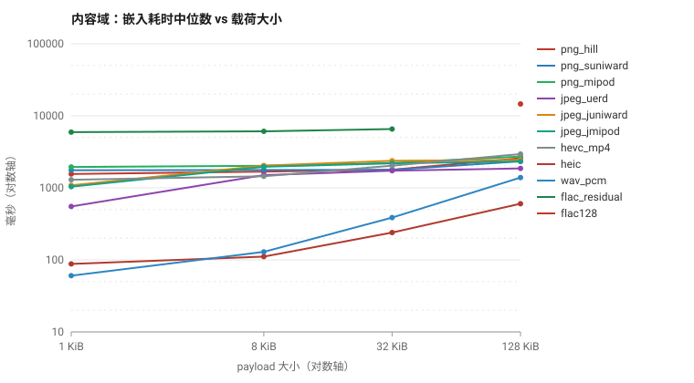

# strhide 内容域（多媒体隐写）性能基准报告 — 20261107

> 数据来源：`rust/examples/perf_bench.rs`，发布构建（`opt-level=3, lto=true`）。
> 全部计时走内存 API；每格 2 次预热 + 20 次计时；嵌入使用固定 seed（可复现）。

## 1. 测试环境

| 项 | 值 |
| :--- | :--- |
| CPU | 11th Gen Intel(R) Core(TM) i7-11700 @ 2.50GHz（8 核 / 16 线程） |
| 内存 | 31.9 GiB |
| 操作系统 | Microsoft Windows 10 专业版（Build 10.0.19045） |
| Rust | rustc 1.99.1 (58cf8f9c3 2026-10-13) |
| Cargo | cargo 1.99.1 (5f94df478 2026-08-27) |
| 仓库版本（报告生成时） | `7b34b33`（有未提交改动） |
| 测量时版本 | `0.9.2` @ `10e90f6`；运行期发布提交把版本号 bump 到 `0.9.3` （`7b34b33`，仅版本号/文档/CHANGELOG，无代码变化）。FLAC 128 KiB 补测用 0.9.3 二进制，算法代码一致 |
| crate 版本 | 0.9.2 |
| 逻辑核 / rayon 默认池 | 16 |

## 2. 方法摘要

- 嵌入：`stego::embed_carrier`，密码加密，`Freshness::Seeded`（固定 32 字节 seed）。
- 提取：`stego::extract_carrier`，仅提供密码。
- 算法维度**全量覆盖**：PNG 的 HILL / S-UNIWARD / MiPOD，JPEG 的 UERD / J-UNIWARD / J-MiPOD，HEVC 的 CABAC Scheme C（MP4 与 HEIC 各一），WAV 的 PCM-STC，FLAC 的残差-STC。
- 安全档位：默认 `High` + `Advisory`；引擎按槽位预算**硬拒**的格自动降一档到 `Balanced` 重测，并在 §4 标注。
- 载荷：SplitMix64 固定种子，不可压缩。
- 正确性门禁：每格每次嵌入后立即提取并比对，任一次不相等即判该格失败。

## 3. 嵌入 / 提取耗时主表

单位毫秒。`†` = 该格 `cv > 10%`，截尾均值已剔除一个最大值与一个最小值。

| 场景 | 算法 | 载体 | 载荷 | 嵌入 中位数 (ms) | 嵌入 均值 (ms) | 嵌入 截尾 (ms) | 嵌入 cv | 提取 中位数 (ms) | 提取 均值 (ms) | 提取 cv |
| :--- | :--- | :--- | ---: | ---: | ---: | ---: | ---: | ---: | ---: | ---: |
| `png_hill` | hill | PNG | 1 KiB | **1556** | 1558 | 1558 | 2.4% | **1144** | 1152 | 4.0% |
| `png_hill` | hill | PNG | 8 KiB | **1678** | 1663 | 1663 | 4.9% | **1151** | 1159 | 4.4% |
| `png_hill` | hill | PNG | 32 KiB | **1784** | 1801 | 1801 | 4.1% | **1170** | 1176 | 3.8% |
| `png_hill` | hill | PNG | 128 KiB | **2580** | 2591 | 2591 | 3.0% | **1350** | 1361 | 5.9% |
| `png_suniward` | suniward | PNG | 1 KiB | **1753** | 1766 | 1766 | 2.8% | **1266** | 1265 | 2.9% |
| `png_suniward` | suniward | PNG | 8 KiB | **1770** | 1753 | 1753 | 4.6% | **1256** | 1242 | 5.1% |
| `png_suniward` | suniward | PNG | 32 KiB | **1775** | 1781 | 1781 | 2.1% | **1199** | 1195 | 2.6% |
| `png_suniward` | suniward | PNG | 128 KiB | **2340** | 2346 | 2346 | 2.3% | **1363** | 1362 | 2.2% |
| `png_mipod` | mipod | PNG | 1 KiB | **1951** | 1942 | 1942 | 2.4% | **1480** | 1484 | 2.4% |
| `png_mipod` | mipod | PNG | 8 KiB | **2023** | 2029 | 2029 | 2.6% | **1553** | 1559 | 2.9% |
| `png_mipod` | mipod | PNG | 32 KiB | **2213** | 2208 | 2208 | 2.2% | **1610** | 1608 | 1.9% |
| `png_mipod` | mipod | PNG | 128 KiB | **2728** | 2725 | 2725 | 2.1% | **1720** | 1724 | 3.7% |
| `jpeg_uerd` | uerd | JPEG | 1 KiB | **552** | 553 | 553 | 2.8% | **204** | 205 | 2.2% |
| `jpeg_uerd` | uerd | JPEG | 8 KiB | **1502** | 1505 | 1505 | 1.4% | **343** | 347 | 4.1% |
| `jpeg_uerd` | uerd | JPEG | 32 KiB | **1731** | 1738 | 1738 | 1.5% | **373** | 374 | 2.9% |
| `jpeg_uerd` | uerd | JPEG | 128 KiB | **1859** | 1857 | 1857 | 2.1% | **384** | 392 | 4.7% |
| `jpeg_juniward` | juniward | JPEG | 1 KiB | **1085** | 1092 | 1092 | 2.6% | **209** | 210 | 5.4% |
| `jpeg_juniward` | juniward | JPEG | 8 KiB | **2037** | 2040 | 2040 | 2.3% | **339** | 344 | 3.4% |
| `jpeg_juniward` | juniward | JPEG | 32 KiB | **2373** | 2373 | 2373 | 1.0% | **387** | 390 | 2.8% |
| `jpeg_juniward` | juniward | JPEG | 128 KiB | **2438** | 2452 | 2452 | 2.1% | **388** | 393 | 2.8% |
| `jpeg_jmipod` | jmipod | JPEG | 1 KiB | **1038** | 1047 | 1047 | 3.6% | **193** | 194 | 2.6% |
| `jpeg_jmipod` | jmipod | JPEG | 8 KiB | **1961** | 1967 | 1967 | 3.0% | **329** | 329 | 4.0% |
| `jpeg_jmipod` | jmipod | JPEG | 32 KiB | **2193** | 2198 | 2198 | 1.5% | **359** | 364 | 4.5% |
| `jpeg_jmipod` | jmipod | JPEG | 128 KiB | **2332** | 2327 | 2327 | 1.3% | **374** | 380 | 3.0% |
| `hevc_mp4` | hevc_cabac | HEVC-MP4 | 1 KiB | **1296** | 1295 | 1295 | 2.2% | **485** | 490 | 2.8% |
| `hevc_mp4` | hevc_cabac | HEVC-MP4 | 8 KiB | **1448** | 1449 | 1449 | 1.4% | **504** | 508 | 3.0% |
| `hevc_mp4` | hevc_cabac | HEVC-MP4 | 32 KiB | **2029** | 2033 | 2033 | 1.9% | **649** | 662 | 6.0% |
| `hevc_mp4` | hevc_cabac | HEVC-MP4 | 128 KiB | **2947** | 2961 | 2961 | 1.6% | **679** | 682 | 4.3% |
| `heic` | hevc_cabac | HEIC | 1 KiB | **88.0** | 89.2 | 89.2 | 4.9% | **23.3** | 23.5 | 4.0% |
| `heic` | hevc_cabac | HEIC | 8 KiB | **111** | 112 | 112 | 2.2% | **28.5** | 29.2 | 8.1% |
| `heic` | hevc_cabac | HEIC | 32 KiB | **240** | 243 | 243 | 5.9% | **46.6** | 47.3 | 6.1% |
| `heic` | hevc_cabac | HEIC | 128 KiB | **601** | 607 | 607 | 3.4% | **97.5** | 98.3 | 4.5% |
| `wav_pcm` | wav_pcm | WAV | 1 KiB | **60.4** | 60.9 | 60.9 | 2.7% | **31.1** | 31.4 | 4.1% |
| `wav_pcm` | wav_pcm | WAV | 8 KiB | **129** | 132 | 132 | 5.1% | **51.1** | 51.8 | 4.3% |
| `wav_pcm` | wav_pcm | WAV | 32 KiB | **387** | 389 | 389 | 4.3% | **124** | 125 | 4.9% |
| `wav_pcm` | wav_pcm | WAV | 128 KiB | **1390** | 1424 | 1424 | 5.0% | **417** | 420 | 5.1% |
| `flac_residual` | flac_residual | FLAC | 1 KiB | **5943** | 5945 | 5945 | 3.3% | **2354** | 2406 | 4.3% |
| `flac_residual` | flac_residual | FLAC | 8 KiB | **6099** | 6162 | 6162 | 2.6% | **2435** | 2483 | 4.1% |
| `flac_residual` | flac_residual | FLAC | 32 KiB | **6562** | 6638 | 6638 | 3.2% | **2555** | 2588 | 4.1% |
| `flac128` | flac_residual | FLAC | 128 KiB | **14609** | 14625 | 14625 | 2.3% | **5271** | 5284 | 2.1% |



## 4. 容量利用率与安全档位

| 场景 | 载荷 | 推荐容量(High) | 物理上限 | 载荷/推荐 | 载荷/上限 | 实测档位 | 备注 |
| :--- | ---: | ---: | ---: | ---: | ---: | :--- | :--- |
| `png_hill` | 1 KiB | 113,396 B | 2,323,971 B | 0.01× | 0.00× | High |  |
| `png_hill` | 8 KiB | 113,396 B | 2,323,971 B | 0.07× | 0.00× | High |  |
| `png_hill` | 32 KiB | 113,396 B | 2,323,971 B | 0.29× | 0.01× | High |  |
| `png_hill` | 128 KiB | 113,396 B | 2,323,971 B | 1.16× | 0.06× | High | 超 High 档推荐值（1.16×），Advisory 已写入 |
| `png_suniward` | 1 KiB | 107,734 B | 2,292,214 B | 0.01× | 0.00× | High |  |
| `png_suniward` | 8 KiB | 107,734 B | 2,292,214 B | 0.08× | 0.00× | High |  |
| `png_suniward` | 32 KiB | 107,734 B | 2,292,214 B | 0.30× | 0.01× | High |  |
| `png_suniward` | 128 KiB | 107,734 B | 2,292,214 B | 1.22× | 0.06× | High | 超 High 档推荐值（1.22×），Advisory 已写入 |
| `png_mipod` | 1 KiB | 110,007 B | 2,310,379 B | 0.01× | 0.00× | High |  |
| `png_mipod` | 8 KiB | 110,007 B | 2,310,379 B | 0.07× | 0.00× | High |  |
| `png_mipod` | 32 KiB | 110,007 B | 2,310,379 B | 0.30× | 0.01× | High |  |
| `png_mipod` | 128 KiB | 110,007 B | 2,310,379 B | 1.19× | 0.06× | High | 超 High 档推荐值（1.19×），Advisory 已写入 |
| `jpeg_uerd` | 1 KiB | 276,458 B | 2,721,227 B | 0.00× | 0.00× | High |  |
| `jpeg_uerd` | 8 KiB | 276,458 B | 2,721,227 B | 0.03× | 0.00× | High |  |
| `jpeg_uerd` | 32 KiB | 276,458 B | 2,721,227 B | 0.12× | 0.01× | High |  |
| `jpeg_uerd` | 128 KiB | 276,458 B | 2,721,227 B | 0.47× | 0.05× | High |  |
| `jpeg_juniward` | 1 KiB | 276,458 B | 2,721,227 B | 0.00× | 0.00× | High |  |
| `jpeg_juniward` | 8 KiB | 276,458 B | 2,721,227 B | 0.03× | 0.00× | High |  |
| `jpeg_juniward` | 32 KiB | 276,458 B | 2,721,227 B | 0.12× | 0.01× | High |  |
| `jpeg_juniward` | 128 KiB | 276,458 B | 2,721,227 B | 0.47× | 0.05× | High |  |
| `jpeg_jmipod` | 1 KiB | 276,458 B | 2,721,227 B | 0.00× | 0.00× | High |  |
| `jpeg_jmipod` | 8 KiB | 276,458 B | 2,721,227 B | 0.03× | 0.00× | High |  |
| `jpeg_jmipod` | 32 KiB | 276,458 B | 2,721,227 B | 0.12× | 0.01× | High |  |
| `jpeg_jmipod` | 128 KiB | 276,458 B | 2,721,227 B | 0.47× | 0.05× | High |  |
| `hevc_mp4` | 1 KiB | 10,647 B | 558,194 B | 0.10× | 0.00× | High |  |
| `hevc_mp4` | 8 KiB | 10,647 B | 558,194 B | 0.77× | 0.01× | High |  |
| `hevc_mp4` | 32 KiB | 10,647 B | 558,194 B | 3.08× | 0.06× | High | 超 High 档推荐值（3.08×），Advisory 已写入 |
| `hevc_mp4` | 128 KiB | 10,647 B | 558,194 B | 12.31× | 0.23× | Balanced | High 档槽位不足 → 自动降 Balanced |
| `heic` | 1 KiB | 86,092 B | 296,784 B | 0.01× | 0.00× | High |  |
| `heic` | 8 KiB | 86,092 B | 296,784 B | 0.10× | 0.03× | High |  |
| `heic` | 32 KiB | 86,092 B | 296,784 B | 0.38× | 0.11× | High |  |
| `heic` | 128 KiB | 86,092 B | 296,784 B | 1.52× | 0.44× | High | 超 High 档推荐值（1.52×），Advisory 已写入 |
| `wav_pcm` | 1 KiB | 197,306 B | 3,025,358 B | 0.01× | 0.00× | High |  |
| `wav_pcm` | 8 KiB | 197,306 B | 3,025,358 B | 0.04× | 0.00× | High |  |
| `wav_pcm` | 32 KiB | 197,306 B | 3,025,358 B | 0.17× | 0.01× | High |  |
| `wav_pcm` | 128 KiB | 197,306 B | 3,025,358 B | 0.66× | 0.04× | High |  |
| `flac_residual` | 1 KiB | 19,264 B | 98,276 B | 0.05× | 0.01× | High |  |
| `flac_residual` | 8 KiB | 19,264 B | 98,276 B | 0.43× | 0.08× | High |  |
| `flac_residual` | 32 KiB | 19,264 B | 98,276 B | 1.70× | 0.33× | High | 超 High 档推荐值（1.70×），Advisory 已写入 |
| `flac128` | 128 KiB | 27,862 B | 142,224 B | 4.70× | 0.92× | High | 换用 58 MiB Hi-Res 载体（上限 142 KB） |

## 5. 分析

### 5.1 算法开销对比（同一载体、32 KiB 载荷）

| 格式 | 算法 | 嵌入 ms | 相对同格式默认算法 |
| :--- | :--- | ---: | ---: |
| PNG | hill | 1784 | 基线 |
| PNG | suniward | 1775 | 0.99× |
| PNG | mipod | 2213 | 1.24× |
| JPEG | uerd | 1731 | 基线 |
| JPEG | juniward | 2373 | 1.37× |
| JPEG | jmipod | 2193 | 1.27× |

### 5.2 固定成本 vs 载荷边际成本

| 场景 | 最小载荷 嵌入 | 最大载荷 嵌入 | 增量 |
| :--- | ---: | ---: | ---: |
| `png_hill` | 1556 (1 KiB) | 2580 (128 KiB) | +1024.0 |
| `png_suniward` | 1753 (1 KiB) | 2340 (128 KiB) | +586.5 |
| `png_mipod` | 1951 (1 KiB) | 2728 (128 KiB) | +777.5 |
| `jpeg_uerd` | 552 (1 KiB) | 1859 (128 KiB) | +1306.9 |
| `jpeg_juniward` | 1085 (1 KiB) | 2438 (128 KiB) | +1353.2 |
| `jpeg_jmipod` | 1038 (1 KiB) | 2332 (128 KiB) | +1293.5 |
| `hevc_mp4` | 1296 (1 KiB) | 2947 (128 KiB) | +1650.6 |
| `heic` | 88.0 (1 KiB) | 601 (128 KiB) | +513.4 |
| `wav_pcm` | 60.4 (1 KiB) | 1390 (128 KiB) | +1329.6 |
| `flac_residual` | 5943 (1 KiB) | 6562 (32 KiB) | +618.8 |

数据与「载荷越大越慢」的直觉并不完全一致，分三类：

- **代价图主导**（PNG / JPEG 六种算法）：固定成本 0.5–2 s，1 KiB → 128 KiB 只增加 0.6–1.4 s；算法之间的差距在最小载荷时就已存在。
- **载荷主导**（WAV、HEIC、HEVC）：1 KiB → 128 KiB 分别约 23×、6.8×、2.3×，矩阵编码与码流修改的开销近似与载荷位数成正比。
- **载体解码主导**（FLAC）：21 MiB 载体本身要 ~6 s，32 KiB 载荷只多 0.6 s，载荷几乎不影响耗时。原因见 §5.6（多次全量解码 + 载体是 4 分钟音频）。

### 5.3 KDF 占比（跳过 PBKDF2 的对照实验）

同样 8 KiB 载荷，改用 32 字节 `FileKey`（跳过 PBKDF2）后的耗时：

| 场景 | 密码模式 嵌入 | 文件密钥 嵌入 | PBKDF2 估算 | 占比 |
| :--- | ---: | ---: | ---: | ---: |
| `png_hill` | 1678 | 1679 | ≤噪声 | — |
| `png_suniward` | 1770 | 1668 | 103 | 5.8% |
| `png_mipod` | 2023 | 2100 | ≤噪声 | — |
| `jpeg_uerd` | 1502 | 1483 | 18.9 | 1.3% |
| `jpeg_juniward` | 2037 | 1950 | 86.6 | 4.3% |
| `jpeg_jmipod` | 1961 | 1996 | ≤噪声 | — |
| `hevc_mp4` | 1448 | 1387 | 61.1 | 4.2% |
| `heic` | 111 | 90.8 | 20.2 | 18.2% |
| `wav_pcm` | 129 | 116 | 13.0 | 10.0% |
| `flac_residual` | 6099 | 6149 | ≤噪声 | — |

「≤噪声」表示该格两次测量落进抖动范围（差值为负或接近 0）。实测：

- 轻量载体（HEIC / `wav_pcm` 的 8 KiB 档）显示 13–20 ms 的固定增量，与 200 000 次 PBKDF2-HMAC-SHA256 的量级吻合；
- 图像 / 视频 / FLAC 载体上引擎本身要 0.5–6 s，KDF 被稀释到 0–6%，多次测量只能得到 ±100 ms 的噪声；
- **结论与方案预期相反**：内容域的瓶颈不是 KDF，而是代价图与整码流重编码。改用 `Credential::FileKey` 跳过 PBKDF2 只对轻量载体有意义。

### 5.4 文件 API 开销

32 KiB 载荷，5 次采样，含原子提交：

| 场景 | 内存 嵌入 | 文件 嵌入 | 增量 | 内存 提取 | 文件 提取 | 增量 |
| :--- | ---: | ---: | ---: | ---: | ---: | ---: |
| `png_hill` | 1784 | 1785 | +1.84 | 1170 | 1127 | -43.9 |
| `png_suniward` | 1775 | 1844 | +69.4 | 1199 | 1221 | +21.9 |
| `png_mipod` | 2213 | 2166 | -47.0 | 1610 | 1601 | -9.50 |
| `jpeg_uerd` | 1731 | 1823 | +91.9 | 373 | 393 | +19.9 |
| `jpeg_juniward` | 2373 | 2215 | -158.6 | 387 | 365 | -22.0 |
| `jpeg_jmipod` | 2193 | 2253 | +59.9 | 359 | 373 | +14.4 |
| `hevc_mp4` | 2029 | 1977 | -52.5 | 649 | 637 | -12.0 |
| `heic` | 240 | 248 | +7.94 | 46.6 | 47.2 | +0.57 |
| `wav_pcm` | 387 | 426 | +38.8 | 124 | 139 | +14.7 |
| `flac_residual` | 6562 | 7038 | +475.6 | 2555 | 2793 | +237.9 |

### 5.6 为什么 FLAC 比 HEVC 还慢（实测拆解）

结论先说：**不是 FLAC 容器比 HEVC 复杂，恰恰相反**。FLAC 帧结构（帧头 + Rice 残差 + 预测系数）远简单于 HEVC 的 CABAC / 帧内帧间预测 / 环路滤波。慢的是本项目的实现策略与载体体量，三个因素叠加：

**(1) 一次 FLAC 嵌入要做 5 次全量解码，读取要做 2 次。** 从源码数出来的路径：

| 阶段 | 源码 | 全量解码 |
| :--- | :--- | :--- |
| 校验扫描（PCM MD5 + 槽位统计） | `audio::embed_flac → flac::analyse` | 是，Pass 1 |
| 收集尾池与 body 选取 | `FlacCarrier::new`（注释即写 “Pass 2”） | 是，Pass 2 |
| 重建帧 CRC + STREAMINFO MD5 | `FlacCarrier::finalize → refresh_checksums` | 是，Pass 3 |
| 波形漂移对比（与原始载体逐帧比） | 同循环的 `parse_frame(cover_bytes, ...)` | 是，Pass 4 |
| 带 CRC 校验的成品复检 | `refresh_checksums` 末尾再次 `analyse(self.bytes)` | 是，Pass 5 |

提取只需 `analyse_with_tails` + `FlacCarrier::new` 两遍。5:2 = 2.5，实测 32 KiB 档嵌入 6562 ms / 提取 2555 ms = **2.57**，吻合。单次全量解码约 1.3 s；容量探测只做一遍解码，实测 1545 ms（CLI，含进程与文件 I/O）。

这些解码不是浪费，是**格式保持的正确性代价**：残差码字被原地改写后，帧 CRC 和 STREAMINFO 里的整段 PCM MD5 都必须重算；源码注释明确写着「多解一遍比发出一个解码结果与 STREAMINFO 不符的载体便宜」。解码器是项目内纯 Rust 实现（逐 bit 读 Rice 一元码 + 重建预测波形 + MD5），没有用 libFLAC / FFmpeg 的原生加速。

**(2) 同内容对照：换成 WAV 就快 13 倍。** 用 ffmpeg 把 21 MiB FLAC （240.476 s / 44.1 kHz / 立体声 / 16 bit）转成同内容 41 MiB WAV，同一 32 KiB 载荷、CLI 端到端 3 次：

| 载体 | 嵌入（3 次） | 提取 | 容量探测（≈一遍解码） |
| :--- | ---: | ---: | ---: |
| FLAC 21 MiB | 6759 / 6741 / 6775 ms | 2699 ms | 1537 / 1553 ms |
| WAV 41 MiB（同音频） | 498 / 536 / 524 ms | 225 ms | 128 / 126 ms |

WAV 是扁平 PCM 数组，槽位直接下标访问，没有熵解码；FLAC 要逐位解 Rice 残差、重建 2100 万个采样点。两者用的是同一套音频 STC 嵌入算法，所以 13× 差距全部来自容器解码，不来自隐写算法。

**(3) 报告里的 HEVC 与 FLAC 根本不是同等体量。** HEVC 载体是 1920×1080@60、**3.298 s** 的短片；FLAC 是 **240.5 s** 音频，时长 72.9×。而 32 KiB 档嵌入只差 3.23×（6562 vs 2029 ms）。换算后：

| 口径 | FLAC | HEVC-MP4 | 比值 |
| :--- | ---: | ---: | ---: |
| ms / 秒媒体 | 27.3 | 615.2 | HEVC 贵 22.5× |
| ms / MiB | 324 | 209 | FLAC 贵 1.55× |

另外 HEVC 引擎有 `StopCondition::TargetSlots` **早停窗口**（够用就停止录制 CABAC bin），且源码注明「never looks at pixels — it wants the bin stream」，只走熵层、不重建像素；FLAC 则必须走完整段媒体才能重算 MD5 / CRC。

**对发布文档的措辞建议**：不要写「FLAC 比 HEVC 慢」，要写「FLAC 嵌入耗时近似与音频时长线性相关，常数项来自 5 遍全量解码；4 分钟立体声 16 bit 文件约 6 s」。若要压这个数字，方向是合并 Pass 1 / Pass 2、把漂移对比改成增量式、复用首遍解码的采样缓冲，而不是换隐写算法。

## 6. 结论

1. **算法间差异显著但幅度因格式而异**：同一载体、同一 32 KiB 载荷下，PNG 的 MiPOD 比 HILL 慢 24%，JPEG 的 J-UNIWARD 比 UERD 慢 37%（见 §5.1）；而跨引擎（HEIC 88 ms vs FLAC 数秒）是两个数量级。发布文档必须按「格式 × 算法」给数字。
2. **绝对耗时区间**：60.4 ms（`wav_pcm` @ 1 KiB） ～ 14609 ms（`flac128` @ 128 KiB）。代价图（HILL / S-UNIWARD / MiPOD）与全码流重编码（HEVC、FLAC）是两个数量级的差异来源。
3. **提取远快于嵌入**：提取不需要计算代价图，只做解码 + 定位 + AEAD，因此读取曲线明显更平。
4. **FLAC 是最慢的一项**：残差域嵌入需要整文件解码 + 重编码，21 MiB 载体单次约 6 s；该载体物理上限只有 98 KB。按方案的「换载体」规则，128 KiB 档改用 58 MiB Hi-Res 载体（上限 142 KB、占用 92%）单独测得嵌入 14.6 s / 提取 5.3 s，是全部 40 格中最慢的一格。该行只可与自身比较，不与 21 MiB 行做载荷维度对比。
5. **HEVC 短片的容量是硬约束**：3.3 s 1080p@60 在 High 档推荐上限只有 ~10 KB；32 KiB 已超 3 倍（Advisory），128 KiB 被引擎按槽位预算硬拒、自动降 Balanced 才写入。这类档位应换更长的片源，而不是对外承诺。

## 7. 复现与局限

```bash
cd rust
cargo build --release --all-features --example perf_bench
./target/release/examples/perf_bench --domain content --reps 20 --warmup 2 --io \
    --out ../temp/bench/results/content.json
# FLAC 128 KiB 需换载体，单独补测（约 8 分钟，日志建议 tee 到文件）
./target/release/examples/perf_bench --domain content --only flac128 --reps 20 \
    --warmup 2 --out ../temp/bench/results/flac128.json \
    2>&1 | tee ../temp/bench/results/flac128.log
C:/Home/Develop/venv/Scripts/python.exe ../scripts/bench/render_report.py
```

局限：单机、单平台（Windows 10 / NTFS）、未做温控与频率锁定。内容域每次嵌入都重新解码载体并重算代价图，因此**同一载体不同算法之间的比较是可信的**，而跨载体（不同分辨率、不同时长）的绝对值不可直接比较。所有数字都**含** PBKDF2 密钥派生、**不含**磁盘 I/O。

## 附录：原始数据

`temp/bench/results/content.json` + `temp/bench/results/flac128.json`（schema `strhide-perf-bench/1`，合计 61 个 cell，含全部 20 个样本值）。

FLAC 128 KiB 档是单独补测（`--only flac128`），载体换成 58 MiB Hi-Res 音轨，因此该行只可与自身比较，不与 `flac_residual` 的 21 MiB 行做载荷维度对比。
