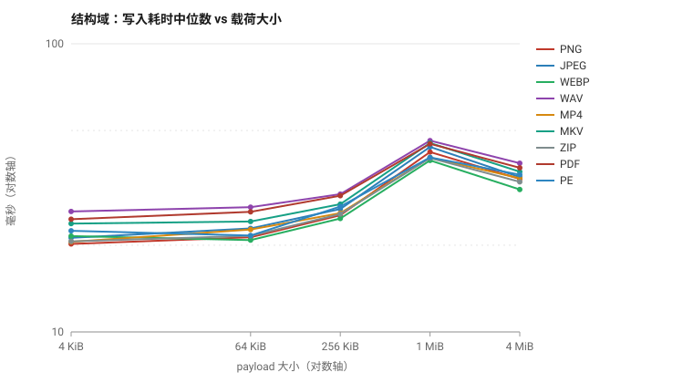

# strhide 结构域（容器信封）性能基准报告 — 20261107

> 数据来源：`rust/examples/perf_bench.rs`，发布构建（`opt-level=3, lto=true`）。
> 全部计时走内存 API，不含文件系统 I/O（I/O 开销见 §5.3）；每格 2 次预热 + 20 次计时。

## 1. 测试环境

| 项 | 值 |
| :--- | :--- |
| CPU | 11th Gen Intel(R) Core(TM) i7-11700 @ 2.50GHz（8 核 / 16 线程） |
| 内存 | 31.9 GiB |
| 操作系统 | Microsoft Windows 10 专业版（Build 10.0.19045） |
| Rust | rustc 1.99.1 (58cf8f9c3 2026-10-13) |
| Cargo | cargo 1.99.1 (5f94df478 2026-08-27) |
| 仓库版本（报告生成时） | `7b34b33`（有未提交改动） |
| 测量时版本 | `0.9.2` @ `10e90f6`；运行期发布提交把版本号 bump 到 `0.9.3` （`7b34b33`，仅版本号/文档/CHANGELOG，无代码变化）。FLAC 128 KiB 补测用 0.9.3 二进制，算法代码一致 |
| crate 版本 | 0.9.2 |
| 逻辑核 / rayon 默认池 | 16 |

## 2. 方法摘要

- 写入：`structure::write_carrier_bytes`（内存 → 内存），策略 `auto`，密码加密开启，`preserve_time` 默认、`backup=false`。
- 读取：`structure::read_carrier_bytes`，仅提供密码。
- 载荷：SplitMix64 固定种子生成，**不可压缩**，因此 Deflate 退化为 stored，表内数字代表「最坏情况」（可压缩载荷见 §5.4）。
- 固定参数：密码 `strhide-bench-v1`，20 次计时样本，2 次预热。
- 正确性门禁：每格首轮校验 `read == payload` 且 `restore == cover`（逐字节），不计时。
- 统计：中位数为主值；`cv > 10%` 时给出剔除一个最大值与一个最小值的截尾均值（`†`）。

## 3. 写入 / 读取耗时主表

**所有耗时列单位为毫秒（ms）**。`cv` 为变异系数；`†` 表示该格方差超阈值、已启用截尾均值。

| 载体 | 载荷 | 写入 中位数 | 写入 均值 | 写入 截尾 | 写入 cv | 读取 中位数 | 读取 均值 | 读取 cv |
| :--- | ---: | ---: | ---: | ---: | ---: | ---: | ---: | ---: |
| PNG | 4 KiB | **20.2** | 20.5 | 20.5 | 4.1% | **21.0** | 21.1 | 4.6% |
| PNG | 64 KiB | **21.3** | 21.4 | 21.4 | 3.2% | **20.8** | 21.0 | 4.2% |
| PNG | 256 KiB | **25.4** | 25.7 | 25.7 | 3.4% | **21.1** | 21.8 | 6.0% |
| PNG | 1 MiB | **42.1** | 42.1 | 42.1 | 5.9% | **22.6** | 22.8 | 4.4% |
| PNG | 4 MiB | **34.0** | 34.4 | 34.4 | 5.1% | **27.1** | 28.1 | 11.8% |
| JPEG | 4 KiB | **21.2** | 21.6 | 21.6 | 4.6% | **21.0** | 21.1 | 2.5% |
| JPEG | 64 KiB | **22.9** | 23.3 | 23.3 | 9.1% | **21.4** | 21.5 | 4.0% |
| JPEG | 256 KiB | **26.7** | 26.9 | 26.9 | 3.4% | **21.6** | 21.7 | 2.6% |
| JPEG | 1 MiB | **43.9** | 45.3 | 45.0† | 10.1% | **22.8** | 23.3 | 6.3% |
| JPEG | 4 MiB | **34.5** | 35.3 | 35.3 | 8.6% | **28.0** | 28.1 | 3.4% |
| WebP | 4 KiB | **21.5** | 21.7 | 21.7 | 7.5% | **22.3** | 22.0 | 5.2% |
| WebP | 64 KiB | **20.8** | 21.0 | 21.0 | 3.7% | **20.9** | 20.8 | 2.8% |
| WebP | 256 KiB | **24.8** | 25.1 | 25.1 | 4.9% | **20.8** | 21.3 | 5.5% |
| WebP | 1 MiB | **39.4** | 40.2 | 40.2 | 4.5% | **21.9** | 22.0 | 4.2% |
| WebP | 4 MiB | **31.2** | 31.4 | 31.4 | 2.6% | **26.2** | 26.3 | 1.6% |
| WAV | 4 KiB | **26.2** | 27.1 | 27.1 | 8.7% | **21.2** | 21.7 | 7.0% |
| WAV | 64 KiB | **27.1** | 27.3 | 27.3 | 3.9% | **20.6** | 20.6 | 3.0% |
| WAV | 256 KiB | **30.1** | 30.2 | 30.2 | 2.8% | **20.6** | 20.7 | 1.9% |
| WAV | 1 MiB | **46.1** | 46.9 | 46.9 | 5.8% | **22.5** | 22.8 | 6.1% |
| WAV | 4 MiB | **38.5** | 39.9 | 39.3† | 10.3% | **26.5** | 27.0 | 5.7% |
| MP4 | 4 KiB | **20.5** | 20.9 | 20.9 | 4.1% | **20.7** | 20.8 | 2.7% |
| MP4 | 64 KiB | **22.7** | 23.1 | 23.1 | 8.8% | **21.9** | 21.8 | 5.4% |
| MP4 | 256 KiB | **25.8** | 26.4 | 26.4 | 6.3% | **20.8** | 21.2 | 7.3% |
| MP4 | 1 MiB | **40.3** | 41.4 | 41.4 | 6.7% | **22.9** | 23.1 | 6.4% |
| MP4 | 4 MiB | **34.1** | 34.8 | 34.8 | 7.8% | **27.2** | 27.7 | 5.9% |
| MKV | 4 KiB | **23.8** | 24.2 | 24.2 | 5.9% | **21.1** | 21.4 | 6.4% |
| MKV | 64 KiB | **24.2** | 24.2 | 24.2 | 3.4% | **20.4** | 20.7 | 3.4% |
| MKV | 256 KiB | **27.7** | 27.9 | 27.9 | 3.0% | **20.8** | 20.9 | 2.4% |
| MKV | 1 MiB | **45.3** | 46.4 | 46.4 | 8.4% | **22.5** | 22.9 | 6.4% |
| MKV | 4 MiB | **36.0** | 36.3 | 36.3 | 5.3% | **27.1** | 27.1 | 2.8% |
| ZIP | 4 KiB | **20.6** | 21.0 | 21.0 | 6.2% | **21.0** | 21.6 | 6.2% |
| ZIP | 64 KiB | **21.6** | 21.7 | 21.7 | 3.1% | **21.0** | 21.3 | 3.9% |
| ZIP | 256 KiB | **25.7** | 25.7 | 25.7 | 5.1% | **21.3** | 21.6 | 5.2% |
| ZIP | 1 MiB | **40.1** | 40.8 | 40.8 | 5.6% | **22.4** | 22.5 | 2.8% |
| ZIP | 4 MiB | **33.2** | 33.7 | 33.7 | 6.4% | **26.9** | 27.7 | 7.3% |
| PDF | 4 KiB | **24.6** | 25.5 | 25.5 | 7.2% | **21.0** | 21.5 | 7.3% |
| PDF | 64 KiB | **26.1** | 26.9 | 26.9 | 7.9% | **21.1** | 21.6 | 6.3% |
| PDF | 256 KiB | **29.7** | 30.0 | 30.0 | 5.3% | **21.0** | 21.1 | 2.9% |
| PDF | 1 MiB | **45.0** | 45.6 | 45.6 | 4.4% | **22.5** | 22.9 | 7.5% |
| PDF | 4 MiB | **37.1** | 37.8 | 37.8 | 8.2% | **26.8** | 27.1 | 3.8% |
| PE | 4 KiB | **22.4** | 22.7 | 22.7 | 8.5% | **21.7** | 22.1 | 8.3% |
| PE | 64 KiB | **21.6** | 21.9 | 21.9 | 3.0% | **20.1** | 20.3 | 2.2% |
| PE | 256 KiB | **27.2** | 27.7 | 27.7 | 9.5% | **21.4** | 21.8 | 5.0% |
| PE | 1 MiB | **40.3** | 40.9 | 40.9 | 4.0% | **22.1** | 22.5 | 5.6% |
| PE | 4 MiB | **35.1** | 35.7 | 35.7 | 6.3% | **27.8** | 28.7 | 9.4% |



## 4. 策略与信封开销

| 载体 | 载荷 | 实际策略 | 信封大小 | stego 大小 | 说明 |
| :--- | ---: | :--- | ---: | ---: | :--- |
| PNG | 4 KiB | `chunk` | 4,321 B | 91,187 B | Embedded into compliant PNG private ancillary chunk 'prIv' before IEND |
| PNG | 64 KiB | `chunk` | 65,762 B | 152,628 B | Embedded into compliant PNG private ancillary chunk 'prIv' before IEND |
| PNG | 256 KiB | `chunk` | 262,370 B | 349,236 B | Embedded into compliant PNG private ancillary chunk 'prIv' before IEND |
| PNG | 1 MiB | `chunk` | 1,048,802 B | 1,135,668 B | Embedded into compliant PNG private ancillary chunk 'prIv' before IEND |
| PNG | 4 MiB | `chunk` | 4,194,551 B | 4,281,417 B | Embedded into compliant PNG private ancillary chunk 'prIv' before IEND |
| JPEG | 4 KiB | `app_segment` | 4,321 B | 975,255 B | Embedded into compliant JPEG APP15 segment |
| JPEG | 64 KiB | `app_segment` | 65,762 B | 1,036,700 B | Embedded into compliant JPEG APP15 segment |
| JPEG | 256 KiB | `app_segment` | 262,370 B | 1,233,320 B | Embedded into compliant JPEG APP15 segment |
| JPEG | 1 MiB | `app_segment` | 1,048,802 B | 2,019,800 B | Embedded into compliant JPEG APP15 segment |
| JPEG | 4 MiB | `app_segment` | 4,194,551 B | 5,165,741 B | Embedded into compliant JPEG APP15 segment |
| WebP | 4 KiB | `eof` | 4,321 B | 13,253 B | Carrier layout or payload did not fit the RIFF chunk strategy |
| WebP | 64 KiB | `eof` | 65,762 B | 74,694 B | Carrier layout or payload did not fit the RIFF chunk strategy |
| WebP | 256 KiB | `eof` | 262,370 B | 271,302 B | Carrier layout or payload did not fit the RIFF chunk strategy |
| WebP | 1 MiB | `eof` | 1,048,802 B | 1,057,734 B | Carrier layout or payload did not fit the RIFF chunk strategy |
| WebP | 4 MiB | `eof` | 4,194,551 B | 4,203,483 B | Carrier layout or payload did not fit the RIFF chunk strategy |
| WAV | 4 KiB | `riff_chunk` | 4,321 B | 5,634,174 B | Embedded into compliant WAV private RIFF chunk 'SHRD' |
| WAV | 64 KiB | `riff_chunk` | 65,762 B | 5,695,614 B | Embedded into compliant WAV private RIFF chunk 'SHRD' |
| WAV | 256 KiB | `riff_chunk` | 262,370 B | 5,892,222 B | Embedded into compliant WAV private RIFF chunk 'SHRD' |
| WAV | 1 MiB | `riff_chunk` | 1,048,802 B | 6,678,654 B | Embedded into compliant WAV private RIFF chunk 'SHRD' |
| WAV | 4 MiB | `riff_chunk` | 4,194,551 B | 9,824,404 B | Embedded into compliant WAV private RIFF chunk 'SHRD' |
| MP4 | 4 KiB | `box_uuid` | 4,321 B | 991,283 B | Embedded into compliant ISO BMFF uuid Box |
| MP4 | 64 KiB | `box_uuid` | 65,762 B | 1,052,724 B | Embedded into compliant ISO BMFF uuid Box |
| MP4 | 256 KiB | `box_uuid` | 262,370 B | 1,249,332 B | Embedded into compliant ISO BMFF uuid Box |
| MP4 | 1 MiB | `box_uuid` | 1,048,802 B | 2,035,764 B | Embedded into compliant ISO BMFF uuid Box |
| MP4 | 4 MiB | `box_uuid` | 4,194,551 B | 5,181,513 B | Embedded into compliant ISO BMFF uuid Box |
| MKV | 4 KiB | `ebml_void` | 4,321 B | 3,375,367 B | Embedded into compliant EBML Void element |
| MKV | 64 KiB | `ebml_void` | 65,762 B | 3,436,809 B | Embedded into compliant EBML Void element |
| MKV | 256 KiB | `ebml_void` | 262,370 B | 3,633,417 B | Embedded into compliant EBML Void element |
| MKV | 1 MiB | `ebml_void` | 1,048,802 B | 4,419,849 B | Embedded into compliant EBML Void element |
| MKV | 4 MiB | `ebml_void` | 4,194,551 B | 7,565,599 B | Embedded into compliant EBML Void element |
| ZIP | 4 KiB | `pre_cd_inject` | 4,321 B | 79,559 B | Embedded before Central Directory with adjusted EOCD offset |
| ZIP | 64 KiB | `pre_cd_inject` | 65,762 B | 141,000 B | Embedded before Central Directory with adjusted EOCD offset |
| ZIP | 256 KiB | `pre_cd_inject` | 262,370 B | 337,608 B | Embedded before Central Directory with adjusted EOCD offset |
| ZIP | 1 MiB | `pre_cd_inject` | 1,048,802 B | 1,124,040 B | Embedded before Central Directory with adjusted EOCD offset |
| ZIP | 4 MiB | `pre_cd_inject` | 4,194,551 B | 4,269,789 B | Embedded before Central Directory with adjusted EOCD offset |
| PDF | 4 KiB | `incremental` | 4,321 B | 344,342 B | Embedded into compliant PDF Incremental Update stream ending with %%EOF |
| PDF | 64 KiB | `incremental` | 65,762 B | 405,784 B | Embedded into compliant PDF Incremental Update stream ending with %%EOF |
| PDF | 256 KiB | `incremental` | 262,370 B | 602,393 B | Embedded into compliant PDF Incremental Update stream ending with %%EOF |
| PDF | 1 MiB | `incremental` | 1,048,802 B | 1,388,827 B | Embedded into compliant PDF Incremental Update stream ending with %%EOF |
| PDF | 4 MiB | `incremental` | 4,194,551 B | 4,534,576 B | Embedded into compliant PDF Incremental Update stream ending with %%EOF |
| PE | 4 KiB | `pe_overlay` | 4,321 B | 166,113 B | Embedded into Windows PE image overlay |
| PE | 64 KiB | `pe_overlay` | 65,762 B | 227,554 B | Embedded into Windows PE image overlay |
| PE | 256 KiB | `pe_overlay` | 262,370 B | 424,162 B | Embedded into Windows PE image overlay |
| PE | 1 MiB | `pe_overlay` | 1,048,802 B | 1,210,594 B | Embedded into Windows PE image overlay |
| PE | 4 MiB | `pe_overlay` | 4,194,551 B | 4,356,343 B | Embedded into Windows PE image overlay |

> **策略退化提示**：以下格没有落到该格式的首选结构化策略，数字对应的是回退路径：
>
> - WebP @ 4 KiB → `eof`
> - WebP @ 64 KiB → `eof`
> - WebP @ 256 KiB → `eof`
> - WebP @ 1 MiB → `eof`
> - WebP @ 4 MiB → `eof`
> - PE @ 4 KiB → `pe_overlay`
> - PE @ 64 KiB → `pe_overlay`
> - PE @ 256 KiB → `pe_overlay`
> - PE @ 1 MiB → `pe_overlay`
> - PE @ 4 MiB → `pe_overlay`

## 5. 分析

### 5.1 固定开销与边际成本

| 载体 | 4 KiB 写入 | 4 MiB 写入 | 增量 | 每 MiB 增量 |
| :--- | ---: | ---: | ---: | ---: |
| PNG | 20.2 ms | 34.0 ms | +13.7 ms | 3.44 ms/MiB |
| JPEG | 21.2 ms | 34.5 ms | +13.2 ms | 3.31 ms/MiB |
| WebP | 21.5 ms | 31.2 ms | +9.70 ms | 2.43 ms/MiB |
| WAV | 26.2 ms | 38.5 ms | +12.3 ms | 3.08 ms/MiB |
| MP4 | 20.5 ms | 34.1 ms | +13.6 ms | 3.40 ms/MiB |
| MKV | 23.8 ms | 36.0 ms | +12.2 ms | 3.05 ms/MiB |
| ZIP | 20.6 ms | 33.2 ms | +12.6 ms | 3.14 ms/MiB |
| PDF | 24.6 ms | 37.1 ms | +12.5 ms | 3.13 ms/MiB |
| PE | 22.4 ms | 35.1 ms | +12.7 ms | 3.17 ms/MiB |

4 KiB 与 4 MiB 的差值只有十几毫秒，说明结构域在小载荷区间完全由密钥派生（PBKDF2-HMAC-SHA256，100 000 次）主导；载荷本身的分块加密与容器拼接只是线性叠加的小项。

### 5.2 1 MiB 处的压缩探测台阶（非单调点）

| 载体 | 1 MiB 写入 | 4 MiB 写入 | 差值 |
| :--- | ---: | ---: | ---: |
| PNG | 42.1 ms | 34.0 ms | +8.2 ms |
| JPEG | 43.9 ms | 34.5 ms | +9.4 ms |
| WebP | 39.4 ms | 31.2 ms | +8.2 ms |
| WAV | 46.1 ms | 38.5 ms | +7.6 ms |
| MP4 | 40.3 ms | 34.1 ms | +6.1 ms |
| MKV | 45.3 ms | 36.0 ms | +9.3 ms |
| ZIP | 40.1 ms | 33.2 ms | +6.9 ms |
| PDF | 45.0 ms | 37.1 ms | +7.8 ms |
| PE | 40.3 ms | 35.1 ms | +5.2 ms |

9 个载体一致地出现「1 MiB 比 4 MiB 还慢」。原因不是测量误差，而是 `CompressionStrategy::Auto` 的实现边界：`src/core/crypto.rs` 的 `COMPRESSION_PROBE_MIN_BYTES = 1 MiB`，**大于**该值的载荷先做 256 KiB 分层采样判断是否值得整段 Deflate，**小于等于**该值的载荷直接整段压缩。

随机（不可压缩）载荷两种路径最终都保留原文，但 1 MiB 档白做了一次约 10 ms 的整段压缩，4 MiB 档只做 256 KiB 采样。发布文档若给出「吞吐随载荷线性增长」的结论，会被这个台阶打脸；建议在已知优化项里记一笔（把阈值改成 `>=` 或对 ≤1 MiB 也走采样即可抹平）。

### 5.3 读取侧

读取耗时区间 20.1–28.0 ms（PE @ 64 KiB ～ JPEG @ 4 MiB）。读取同样先做一次 PBKDF2，所以小载荷与大载荷的差距远小于载荷比。

### 5.4 文件 API 开销（内存 API vs 落盘 API）

同一载体、256 KiB 载荷，5 次采样，含原子提交与磁盘写入：

| 载体 | 内存 写入 | 文件 写入 | 增量 | 内存 读取 | 文件 读取 | 增量 |
| :--- | ---: | ---: | ---: | ---: | ---: | ---: |
| PNG | 25.4 | 37.2 | +11.8 | 21.1 | 22.1 | +0.92 |
| JPEG | 26.7 | 36.8 | +10.1 | 21.6 | 21.6 | +0.04 |
| WebP | 24.8 | 34.9 | +10.1 | 20.8 | 20.6 | -0.24 |
| WAV | 30.1 | 46.3 | +16.2 | 20.6 | 20.8 | +0.25 |
| MP4 | 25.8 | 36.3 | +10.4 | 20.8 | 21.3 | +0.49 |
| MKV | 27.7 | 42.3 | +14.5 | 20.8 | 21.3 | +0.51 |
| ZIP | 25.7 | 34.2 | +8.54 | 21.3 | 21.9 | +0.60 |
| PDF | 29.7 | 41.4 | +11.7 | 21.0 | 21.4 | +0.35 |
| PE | 27.2 | 35.5 | +8.25 | 21.4 | 22.5 | +1.08 |

落盘成本主要是「复制 + 原子 rename」，与载荷大小弱相关；在 HDD 或开启实时杀软的环境下这一项会明显放大。

### 5.5 可压缩载荷（Deflate 生效时的代价）

4 MiB 全零载荷（Deflate 压缩后仅数 KB）：

- 写入中位数 **24.4 ms**，读取中位数 **24.5 ms**，信封仅 4,307 B。
- 与同载体 4 MiB 随机载荷相比，压缩省下了容器体积，但多花了 CPU；在 4 MiB 量级上两者处于同一数量级，说明压缩不是结构域的瓶颈。

## 6. 结论

1. **写入**：20.2–46.1 ms（中位数区间），**读取**：20.1–28.0 ms，9 种载体在 4 KiB–4 MiB 全档位上没有出现数量级差异。
2. **主要成本是 PBKDF2**（100 000 次，约 20 ms/次），载荷每增加 1 MiB 只多花数毫秒。因此「小文件隐藏慢」的观感来自密钥派生，而不是加密或容器操作。
3. **策略退化必须写进文档**：WebP 在本轮全部回退 `eof`（RIFF 声明边界不匹配），PE 全部落到 `pe_overlay`。用户若期待「私有块注入」的隐蔽性，需要知道实际走的是哪条路径。
4. **JPEG 的 APP15 段可承载 4 MiB**：引擎会拆成多段，没有 64 KiB 上限问题。
5. 发布对外承诺建议以本文档的写入/读取中位数为准，并注明「含 PBKDF2、不含磁盘 I/O」。

## 7. 复现与局限

```bash
cd rust
cargo build --release --all-features --example perf_bench
./target/release/examples/perf_bench --domain structure --reps 20 --warmup 2 --io \
    --out ../temp/bench/results/structure.json
```

局限：单机、单平台（Windows 10 / NTFS）、未做温控与频率锁定，同机重复跑的绝对值可漂移 ±5%；跨机器比较只看相对比例。所有数字都**含** PBKDF2 密钥派生、**不含**磁盘 I/O。

## 附录：原始数据

`temp/bench/results/structure.json`（schema `strhide-perf-bench/1`，55 个 cell，含全部 20 个样本值）。
