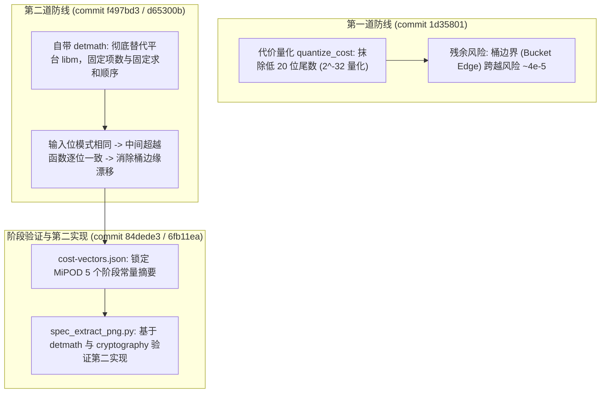

# 隐写格式规范化与跨实现互读互写兼容性分析报告

- **日期**：2026-11-07
- **关联规范**：[`docs/api/WIRE_SPEC_CONTENT.md`](file:///c:/Home/Projects/strhide/docs/api/WIRE_SPEC_CONTENT.md)
- **关联实现**：
  - Rust 核心：[`rust/src/stego/detmath.rs`](file:///c:/Home/Projects/strhide/rust/src/stego/detmath.rs)、[`rust/src/stego/cost_calibration.rs`](file:///c:/Home/Projects/strhide/rust/src/stego/cost_calibration.rs)
  - 辅助与第二实现：`scripts/detmath/`、`scripts/cost_vectors_check.py`、`scripts/spec_extract_png.py`

---

## 一、背景与问题缘起

在 [`docs/api/WIRE_SPEC_CONTENT.md §15.3 写侧参数与互读`](file:///c:/Home/Projects/strhide/docs/api/WIRE_SPEC_CONTENT.md#L926) 表格中，曾记录有一条保守说明：
> `| algorithm_id | 影响 | 1 已规范化；2/3 写入后仅同实现可读（§13.11.4） |`

当时做出“MiPOD（`id=3`）与 S-UNIWARD（`id=2`）写入后仅同实现可读”这一判断的根因如下：

1. **Newton 迭代的误差放大**：
   MiPOD 在将 Fisher 信息量转换为修改代价时，需要求解方程 $\rho \cdot (e^\rho + 2) = x$。其 Newton 求解器的相对容差收敛条件为 $10^{-14}$；
2. **平台 libm 的非确定性**：
   各操作系统和编译器所依赖的数学库（Windows UCRT vs Linux glibc vs musl）在 `exp`、`ln`、`cos` 上存在 1~2 ULP 的舍入差异（IEEE-754 仅规范基础算术，不规范超越函数的正确舍入）。经 Newton 求解器迭代放大后，不同平台计算出的代价差异最高可达 255 ULP（约 $2^{-44}$ 量级）；
3. **槽位排序翻转（Ranking Inversion）导致的解密雪崩**：
   **在空间域（PNG）**中，隐写嵌入依赖对所有候选像素按代价从小到大排序截断选出（§13.11.3）。若两个槽位的真实代价极其接近，这 255 ULP 的漂移会导致排序先后顺序颠倒。一旦排序错位，发送端与接收端选出的像素下标完全不一致，STC（综合校验子网格编码）解码必然失败，最终返回 `NoHiddenData`（与密码错误表现相同）。

---

## 二、演进与两道防线的建立

自 commit `1d35801` 以来，通过一系列系统性重构，该问题已得到彻底解决：

1. **第一道防线：代价末位量化（commit 1d35801）**
   - 在 `fisher_to_costs` 输出时，强制清零低 20 位尾数（`bits & 0xFFFF_FFFF_FFF0_0000`），量化量子为 $2^{-32} \approx 2.3 \times 10^{-10}$；
   - 该量子比实测的 $2^{-44}$ 离散度粗 4 个数量级，吸收了绝大部分常规平滑区间的 libm 漂移。
2. **第二道防线：确定性初等函数 detmath（commit f497bd3 & d65300b）**
   - 彻底移除了格式写入路径上所有的外部 libm 调用，引入自带的 `detmath`（`exp`、`ln`、`ln_1p`、`cos`、`log2`）；
   - 算法仅基于 IEEE-754 基础四则运算与位级移位，项数与累加顺序完全固定，在相同位模式输入下产出 100% 逐位确定的结果，彻底消除了量化截断点附近的跨桶漂移。
3. **逐阶段测试向量与第二实现（commit 84dede3 & 6fb11ea）**
   - 引入 `docs/api/cost-vectors.json`，将 MiPOD 管线的 `plane`、`variance`、`fisher`、`smoothed`、`cost` 五个阶段摘要全部锁死；
   - 编写独立 Python 读取器 `scripts/spec_extract_png.py`（配套 `scripts/detmath/detmath.py` 与 `cryptography` AEAD 解密），**实测在 Windows 和 Ubuntu 上均成功解密读出了 Rust 在 Windows 下嵌入的 MiPOD PNG 载体**。

---

## 三、“互读”与“互写”的不对称性分析

在评判“第三方按照规范能否互相兼容”时，必须明确区分格式载体特性与两个不同的工程级别：

### 0. 载体域架构不对称：空间域 vs 频域 / 容器
- **空间域（PNG）**：**读写两端均需计算代价**。因为正文槽位是按代价升序排序后截断选出的（`candidates = eligible 中按 (cost.to_bits(), px) 升序的前 allowed 个`，§13.11.3），读写双方代价全序哪怕错开一个元素都会导致解密失败；
- **频域（JPEG）与音视频容器**：**只有写端需要代价，读端完全不计算代价**。JPEG 读端槽位完全由 8×8 DCT 块几何网格与 PRNG 置换决定；HEVC 读端由 CABAC bypass 语法网格决定；音频读端由采样/残差结构决定。第三方若仅实现 JPEG/HEVC/音频读取器，**门槛极低，根本无需实现任何复杂的代价模型**。

### 1. PNG 读取兼容（Extract：他人读 strhide PNG 载体）—— 门槛低至中等，已完全成立
- **原理**：解码方需要将候选像素槽位的**相对大小全序（Ranking）**还原一致，即可按相同顺序送入 STC 译码网格；
- **依赖说明**：由于存在 $2^{-32}$ 的粗量化阶梯，不同语言在绝大多数自然图像上能吸收极小波动。但若不使用 `detmath` 而直接依赖平台 libm，理论上仍存在约 $4 \times 10^{-5}$ 的桶边界跨越风险（Bucket Edge Straddling）；一旦跨桶造成排序倒序即会解密失败。因此：
  - **经验/尽力而为（Best-effort）**：常规自然图像直接调用系统默认数学库大概率能读出；
  - **协议级严格保证（100% Deterministic）**：第三方读取器**必须**实现确定性初等函数（直接使用项目提供的 `scripts/detmath/detmath.py` 或 `detmath.go` 参考实现）。第二实现 `spec_extract_png.py` 正是通过引入 `detmath.py` 确保了跨平台 100% 互通。

### 2. 写入互通（Embed：他人写入，strhide 读取）—— 门槛中等，已完全成立
- **原理**：只要他人按规范算出的代价矩阵，其像素优劣排序与官方标准在全序上一致，写入数据后，官方 `strhide` 就能顺畅解密；
- **结论**：**完全支持。**

### 3. 写入逐字节一致（Bit-identical Embedding：跨语言产生 100% 相同载体）—— 门槛较高，理论与基础设施已就绪
- **原理**：要求在相同图片和密码下，第三方生成的隐写图片与官方产物每一个字节乃至 SHA-256 哈希都完全一致。这要求代价不能差哪怕 1 个 ULP，否则在遇到桶边界时可能发生槽位微调；
- **支撑设施**：项目现已在 `scripts/detmath/` 下提供了 Python（`detmath.py`）和 Go（`detmath.go`）的标准移植，并锁定了 5 个散列摘要；
- **移植注意**：Go 语言在 ARM64 等架构下默认会开启 FMA 乘加融合（生成 `fmla` 指令），会导致 1 ULP 的微差。第三方在实现逐字节写入器时，需显式关闭编译器的浮点收缩（fp-contract）。

---

## 四、各媒体格式规范化与跨实现兼容现状

| 格式分类 | 包含算法 | 规范化完备度 | 跨实现互读互写现状与分析 |
|---|---|---|---|
| **图像 PNG** | **HILL** (`id=1`) | **完全规范化** | 公式仅涉及整型高通滤波、绝对值与除法，无任何超越函数，逻辑确定，Python 第二实现已 100% 互读。 |
| **图像 PNG** | **MiPOD** (`id=3`) | **完全规范化** | 数学障碍已彻底扫清（量化 + detmath + 阶段向量锁定），Python 第二读取器实测互通。读端严格互读需配套 `detmath`。 |
| **图像 PNG** | **S-UNIWARD** (`id=2`) | **逻辑可规范化** | 无超越函数，但实现细节极易踩坑（依赖 16 个硬编码的小数截断 Daubechies-8 滤波系数、双向卷积与 clamp 边界延拓；**关键**：`sigma` 参数必须按规范取 `1.0`，不可误用论文的 $2^{-6}$）。只要第三方严格照搬常量即可兼容。 |
| **图像 JPEG** | **UERD / J-UNIWARD / J-MiPOD** | **核心已规范化** | **读端完全无需代价计算**（槽位由块几何网格与 PRNG 置换确定）。写端作用于量化后的 8×8 DCT 频域整型系数（跳过 DC 直流）。J-UNIWARD/J-MiPOD 中的 `cos` 调用已全部接入 `detmath`。线格式完全确定，跨平台（x86/ARM64）28 例字节基线 100% 通过。 |
| **音频 WAV / FLAC** | **PCM 采样 / 残差域** | **完全规范化** | **读端写端均无需复杂代价模型**。WAV 结构极简，直接操作 16/24-bit 整数采样；FLAC 基于已解码的整型残差帧，线格式完全自描述。 |
| **视频 HEVC** (MOV/MP4/HEIC/MKV/Annex-B) | **运动矢量 / 残差系数** | **线格式已定义，但实现门槛极高** | **读端完全无需代价模型**（基于 CABAC bypass 的 `coeff_sign_flag` 调制）。虽然线格式协议完全定义，但外部开发者若想从零写出一个能够重新打包且不破坏语法的 HEVC 写入器，工程代价巨大。 |

---

## 五、结论与文档修正建议

1. **核心结论**：
   - 本项目使用初等函数并不要求极端高精度（~1 ULP 已经完全溢出满足需求），但**要求跨平台、跨语言输出结果 100% 逐位可复现**；
   - 之前因 libm 漂移导致 MiPOD 无法跨实现规范化的障碍已被彻底破除；
   - 除空间域（PNG）需要读写双方精确对齐代价全序外，JPEG、HEVC 和音频的读端本质上无需代价模型，跨实现读取门槛实际上远低于此前预期。
2. **文档更新建议**：
   - 建议在 [`WIRE_SPEC_CONTENT.md §15.3 写侧参数与互读`](file:///c:/Home/Projects/strhide/docs/api/WIRE_SPEC_CONTENT.md#L926) 表格中，将 `algorithm_id` 的描述：
     - *原述*：`1 已规范化；2/3 写入后仅同实现可读（§13.11.4）`
     - *建议修正为*：`1 与 3 (HILL/MiPOD) 已完全规范化并经第二实现实测互读（MiPOD 读端建议配套 detmath 消除桶边界漂移）；2 (S-UNIWARD) 规范已完备（依赖严格一致的 Db8 常量、卷积方向与 sigma=1.0）`。
