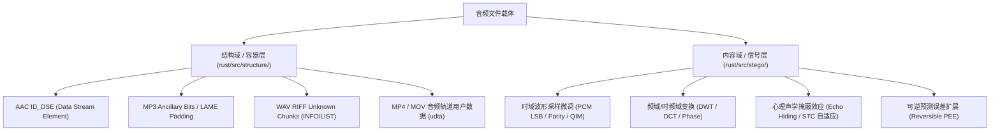

# strhide 音频隐写技术调研与工程集成方案

> **文件标识**：`docs/audio_steganography_research_and_implementation_plan_20261031.md`  
> **编写时间**：2026-10-31  
> **研究依据**：`The-A-Files` 评测框架、`awesome-steganography` 专题库、`audio-stego-project` 以及 CTF 前沿取证技术资料  
> **项目背景**：`strhide` 目前在内容域（`stego/`）支持 PNG、JPEG、HEVC/HEIF，但缺乏音频内容域隐写能力。本文档旨在梳理音频隐写真实机理，厘清结构域与内容域边界，并制定低复杂度、高稳定性的工程集成方案。

---

## 1. 核心概念厘清：内容域（真·隐写）vs 结构域（容器隐藏）

在音频隐写技术中，经常存在术语混淆。为了与 `strhide` 现有的架构保持绝对一致，首先必须对隐写层级进行严格定义：

### 1.1 结构域特性（如 AAC DSE / MP3 Ancillary Bits）
- **机理**：利用格式规范所允许的跳过指针、保留长度字段或非渲染语法块存放载荷。
  - **AAC `ID_DSE (4)`**：标准定义的私有数据流元素，播放器遇到后按声明的字节长度直接 `seek` 跳过。
  - **MP3 `Ancillary Bits`**：每帧音频主数据（Main Data）编码完毕后，剩余未占满的填充位。
- **评定**：音频波形和声音采样**未受任何物理扰动**。任何格式分析器遍历语法树即可直接剥离。它们应归入 `structure/adapters/`，不属于真正的内容域隐写。

### 1.2 内容域真·隐写（Content-Adaptive Signal Steganography）
- **机理**：秘密数据被**微扰并溶解在声音物理信号本身**（时域振幅采样点、量化谱线或相位差）。
- **评定**：
  - 文件中**不存在独立的数据块或长度标志**；
  - 提取端必须运行逆变换/熵解码，依靠密钥 PRNG 读取采样点/系数的奇偶性或 STC 校验子；
  - 具备不可分割性，即使被剥离所有 Metadata/Tag，秘密信息依然存在于声音振幅中。

---

## 2. 压缩音频（MP3 / AAC）内容域隐写的困境与实证实测

针对“为什么最常用的 MP3 和 AAC 极难做低复杂度内容隐写”，基于 `The-A-Files` 与 `awesome-steganography` 的实证分析如下：

| 技术路径 | 代表方案 / 出处 | 工作机理 | 致命痛点与工程阻碍 | 评估结论 |
| :--- | :--- | :--- | :--- | :--- |
| **压缩编码循环干预** | `MP3Stego` (Fabien Petitcolas) | 在从 PCM 压缩到 MP3 时，干预量化内循环微调步长奇偶性 | 必须对输入音频重新执行有损压缩（Generation Loss），导致原音质二次劣化；且强绑定 C 语言 LAME 源码 | **不可取**（违背无损与格式保持原则） |
| **压缩域频域系数修改** | 学术界 MDCT 谱线微调 | 熵解码出量化频域系数，修改某些系数奇偶性后重编码 | **变长 Huffman 膨胀与比特库（Bit Reservoir）雪崩**：MP3/AAC 码字是变长的，微调 1 个系数可能导致码长增加数 bit，超出帧总位预算，引发连续多帧指针失效与刺耳爆音。Rust 生态无现成库支持 | **成本极高**（需自研完整比特流重写器，工期月级） |
| **借用心理声学残差** | `AacStcMethod` (`The-A-Files`) | 将音频通过 AAC 压缩解压得到残差 $r = x - x'$，残差大的地方代表掩蔽度高，用作 STC Cost | **载体实际依然是 PCM (WAV)**，AAC 仅作为类似图像 HILL 的 Cost 计算器，最终修改落在 PCM 采样点上 | **有力证明：真隐写最终还是落地在 PCM** |

---

## 3. 高性价比音频内容域隐写技术选型

通过对比 `The-A-Files` 的 30 种实现与 `audio-stego-project`，以下 5 种技术兼具**高成熟度、极低工程复杂度、高隐蔽性**，是 `strhide` 扩展音频维度的最佳选择：

### 3.1 块奇偶校验编码（Block-Based Parity Coding）—— 极简、高 SNR
- **出处**：`audio-stego-project/TECHNICAL_ANALYSIS.md`
- **数学模型**：
  将连续 16-bit PCM 音频序列分成大小为 $N$（如 $N=32$ 或 $64$）的块 $B_k$。每个块仅承载 1 bit 信息 $b_k$。
  定义块奇偶校验和：
  $$P(B_k) = \left( \sum_{j \in B_k} \text{LSB}(j) \right) \pmod 2$$
  - 若 $P(B_k) == b_k$：完全不修改任何采样点；
  - 若 $P(B_k) \neq b_k$：仅挑选该块中**振幅绝对值最小或能量最低的单个采样点**，执行三元 `±1` 微调。
- **优势**：
  - 采样点修改率从普通 LSB 的 $50\%$ 下降到 $1.5\% \sim 3\%$（降低 30 余倍）；
  - 信噪比（SNR）通常超过 $75\text{dB}$，人耳绝对无法察觉，常规卡方/直方图检测完全失效；
  - **实现难度**：纯 Rust 代码在 120 行以内，运行速度数 GB/s。

### 3.2 量化索引调制（QIM, Quantization Index Modulation）—— 鲁棒性与参数可调
- **出处**：`The-A-Files/src/taf/methods/QimMethod.py`
- **数学模型**：
  选取量化步长 $\Delta$（如 $\Delta = 8$ 或 $16$）。对于采样点 $S$，根据待嵌入比特 $b \in \{0, 1\}$，将其投影到对应的奇/偶量化网格：
  $$S' = \text{round}\left( \frac{S - b \cdot \frac{\Delta}{2}}{\Delta} \right) \cdot \Delta + b \cdot \frac{\Delta}{2}$$
  提取端仅需执行标量模量化：
  $$\hat{b} = \arg\min_{i \in \{0,1\}} |S' - \text{quantize}(S', \Delta, i)|$$
- **优势**：
  - 提取端为**盲提取（Blind Extraction）**，不需要原始宿主参与；
  - 具备抗小幅度音量调整、微弱重采样的天然鲁棒性；
  - 纯标量算术，无复杂矩阵运算。

### 3.3 局部能量梯度自适应 + STC 综合网格码（Adaptive Cost + STC）
- **出处**：复用 `strhide` 现有的 `stego/coding/stc.rs`
- **数学模型**：
  人耳的听觉掩蔽效应表明：**在音频振幅剧烈跳变、高频成分丰富、能量大的时段，人耳对噪声的容忍度极高；在静音或纯低频正弦波段，人耳对微扰极度敏感**。
  可定义每个采样点 $i$ 的局部一阶差分与能量代价：
  $$\rho(i) = \frac{1}{\epsilon + |S(i) - S(i-1)| + \alpha \cdot |S(i)|}$$
  平坦静音区代价 $\rho \to \infty$（禁止修改）；激变噪声区代价 $\rho \to 0$。
- **优势**：
  - 完全复用 `strhide` 现有的综合网格码（STC）求解器；
  - 达到理论失真极值边界，属于学术界最高水准的自适应隐写范式。

### 3.4 可逆预测误差扩展（Reversible PEE）—— 100% 比特级无损还原
- **出处**：`The-A-Files/src/taf/methods/ReversiblePeeMethod.py`
- **数学模型**：
  利用前向线性预测（Linear Predictor）计算当前采样的预测误差 $e(i) = S(i) - \hat{S}(i)$。
  对误差进行扩展嵌入：
  $$e'(i) = 2 \cdot e(i) + b_i$$
  合成隐写采样点：$S'(i) = \hat{S}(i) + e'(i)$。
  提取端解出比特 $b_i = e'(i) \pmod 2$，并通过 $e(i) = \lfloor e'(i) / 2 \rfloor$ 将采样点还原为 $S(i) = \hat{S}(i) + e(i)$。
- **优势**：
  - **完全可逆**：提取信息的同时，宿主音频还原为比特一致的原始文件（哈希完全匹配）；
  - 完美契合 `strhide` 的“无损保持”品牌定位。

### 3.5 时间掩蔽回声隐藏（Echo Hiding / TS-Echo）—— 抗有损压缩生存
- **出处**：`audio-steganography-algorithms/02-Echo-Hiding`
- **数学模型**：
  在原始信号后附加一个极短延迟（$\delta_0 \approx 0.5\text{ms}$, $\delta_1 \approx 1.0\text{ms}$）、振幅极微（$\alpha \approx 0.005$）的人耳不可闻回声核。
  提取端通过倒谱（Cepstrum）求自相关峰值定位延时。
- **优势**：
  - 极强的抗再压缩鲁棒性：**即使音频随后被外部工具转码为 128k MP3 或 AAC，回声特征依然能够在倒谱中稳固提取**。

---

## 4. 推荐载体格式与集成性价比评估

| 载体格式 | 推荐内容域算法 | 依赖与生态 | 预估代码量 | 优势与局限 | 实施优先级 |
| :--- | :--- | :--- | :--- | :--- | :--- |
| **WAV (PCM)** | Block Parity / STC / QIM | 纯 Rust，标准库 + 现有 RIFF 模块 | ~250 行 | 结构最简单，速度极快（GB/s 吞吐），零踩坑点 | **P0（立即实施）** |
| **FLAC** | PCM 解压 -> STC -> 无损重编 | `claxon` (解码) + `flacenc` (纯 Rust 编码) | ~300 行 | 全球主流无损音乐格式，体积比 WAV 小 60%，体验极佳 | **P1（第二阶段）** |
| **AIFF** | 类似 WAV 的大端 PCM 样本 | 纯 Rust 解析 COMM/SSND 块 | ~180 行 | 苹果生态标准未压缩格式，内核与 WAV 完全复用 | **P2（后续扩充）** |
| **MP3/AAC** | 频域 MDCT 系数修改 | 需自研完整位预算配平引擎 | >2500 行 | 难度极大，易产生爆音与兼容问题，不宜过早投入 | **不建议内容域** (建议做结构域) |

---

## 5. 工程实施路线图（三步走）

### 阶段一：建立 `stego/audio/` 模块与 WAV PCM 引擎（工期预估：2~3 天）
1. 在 `rust/src/stego/` 下新增 `audio/` 子模块，定义 `AudioEngine` trait 或直接适配统一的 `StegoEngine`；
2. 实现 `WavEngine`：
   - 解析 RIFF 头，定位 `fmt ` 与 `data` chunk，提取 16-bit 线性 PCM 数据切片；
   - 默认采用 **Block-Based Parity Coding + PRNG 伪随机打乱** 快速通道；
   - 高安全等级模式下复用 `stego/coding/stc.rs` 矩阵编码；
   - 严格保证头部和声道交错（Interleaved L/R）处理正确。

### 阶段二：打通 FLAC 无损压缩载体通道（工期预估：2 天）
1. 引入高质量纯 Rust 依赖 `claxon` 和 `flacenc`；
2. 实现 `FlacEngine`：
   - 解码 FLAC 帧至内存 PCM 缓冲区；
   - 复用阶段一的音频嵌入/提取核心；
   - 将嵌入后的 PCM 数据重新通过 `flacenc` 压缩输出标准 `.flac` 比特流；
   - 验证提取无误并确保元数据 Tags 完整保留。

### 阶段三：拓展可逆 PEE 与回声隐藏模式（工期预估：3 天）
1. 为追求极致无损的用户提供 `--reversible` 模式（基于 PEE 预测误差扩展）；
2. 对需要抗有损格式重压缩的场景，引入基础的回声隐藏（Echo Hiding）探针。
