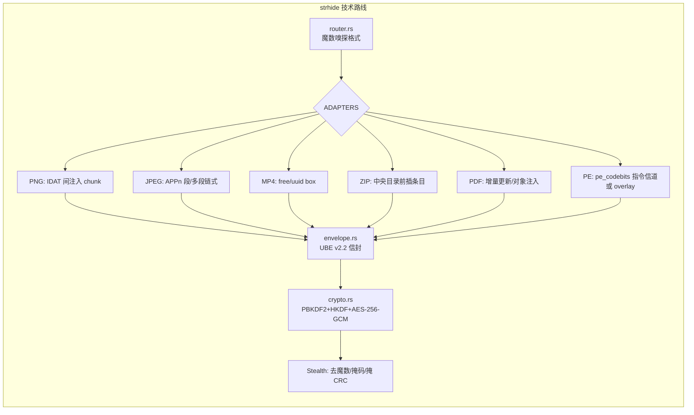
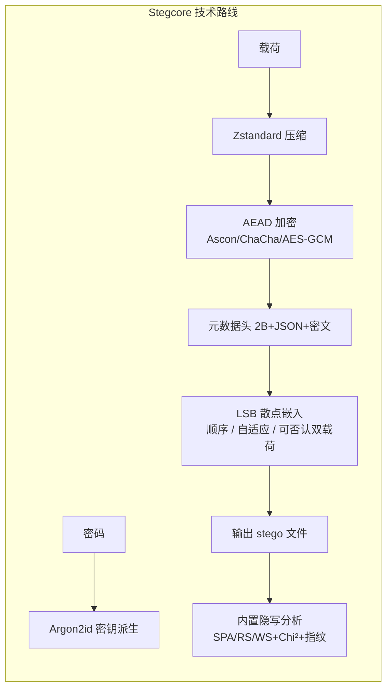

# strhide × conseal × Stegcore 技术路线分析与借鉴报告

> 日期：2026-10-19
> 范围：`C:\Home\Projects\strhide\temp\github\` 下的两个外部开源项目（[conseal](https://github.com/uibk-uncover/conseal) 与 [Stegcore](https://github.com/The-Malware-Files/Stegcore)）与本地 strhide 的三方技术路线系统对比。
> 结论速览：**conseal 在"图像内容隐写算法"维度上确实代表学术前沿，但它是一个"只模拟嵌入、不提供端到端"的研究库，不是 strhide 的替代品；真正值得 strhide 全面借鉴的"更先进"标杆是 Stegcore（内容域实用化 + 隐写分析闭环 + 现代密码学 + 可否认模式）。** 三者技术路线正交，具体结论与借鉴清单见下文。

---

## 1. 三个项目速览

| | **strhide**（本地仓库） | **conseal**（uibk-uncover） | **Stegcore**（The-Malware-Files） |
| --- | --- | --- | --- |
| 定位 | 智能格式保持、无损数据隐藏工具（**实用产品**） | 现代图像隐写算法实现库（**学术研究/模拟器**） | 把加密消息藏进普通图片/声音文件的工具（**实用产品**） |
| 版本/状态 | Rust edition 2024 主力；Python 冻结 0.2.0 | 2026.06，Alpha，研究导向 | v4.0.1，2026 活跃维护 |
| 语言栈 | Rust 单静态二进制 + Python 库（已冻结） | Python（numpy/scipy/numba）+ Rust 加速子集（PyO3/maturin） | Rust workspace（engine/core/cli）+ Tauri v2 GUI + React 前端 |
| 嵌入域 | **文件格式结构层**（元数据空隙） | **图像内容层**（像素 / JPEG DCT 系数） | **图像/音频内容层**（LSB / JSteg DCT / 音频采样 LSB） |
| 端到端能力 | ✅ write/read/verify/remove 完整闭环 | ❌ **仅模拟嵌入**（README 明确声明不提供端到端隐写） | ✅ embed/extract/analyse 完整闭环 |
| 宿主可逆性 | ✅ **100% 逐比特还原**（嵌入原始宿主 SHA-256） | ❌ 嵌入即修改图像，不可还原原图 | ❌ 修改像素/系数，不可还原原图 |
| 加密 | AES-256-GCM（分块）+ PBKDF2-HMAC-SHA256(10⁵) + HKDF-SHA256；Deflate 压缩 | 无（不涉及真实载荷） | 3 种 AEAD（Ascon-128 / ChaCha20-Poly1305 / AES-256-GCM）+ Argon2id + Zstandard |
| 隐写分析/检测 | ❌ 无内置检测（有拒绝/verify 完整性检查） | ❌ 面向研究：产出 stego 供第三方分析 | ✅ 内置 SPA / RS / WS（Aletheia 对齐）+ Chi² + LSB 熵 + 工具指纹 |
| 格式支持 | PNG / JPEG / MP4 / ZIP / PDF / Windows PE（+eof 降级） | 图像（JPEG、PNG 输入，算法级） | PNG / BMP / JPEG / WebP / WAV / FLAC |

---

## 2. 技术路线详解

### 2.1 strhide：格式域"结构嵌入"路线

核心思想：**不修改载体内容，只往文件格式允许的"结构空隙"里注入信封（envelope）**，从而做到视觉/听感零改变、宿主 100% 可逆。



关键工程事实（源码级）：

- **信封格式 UBE v2.2**（`rust/src/envelope.rs`）：112 字节定长头（8B 高熵魔数 + version/flags/strategy_id + 16B salt + 12B nonce + 原始宿主大小 + **原始宿主 SHA-256（32B）** + 注入偏移/大小 + patch 字段 + 元数据长度 + 提示长度）+ 元数据块（compact 二进制或 JSON）+ 载荷 + 24 字节尾（偏移 + 总长 + **CRC32（Stealth 下用密码掩码）** + 4B 魔数）。头字段构成 80B AEAD AAD，绑定防篡改。
- **Stealth 化**：默认魔数取 `SHA-256("strhide-standard-header-v2")` 的前 8 字节（纯高熵伪随机，消除 `STRHIDE`/`STH!` 等静态 ASCII）；Stealth 模式下 header 敏感字段用密码派生掩码 XOR 遮盖，trailer CRC 也用密码派生掩码，**没有密码无法定位信封**。
- **策略路由**（`router.rs`）：`find_adapter` 按魔数嗅探，未识别格式一律拒绝（防损坏带校验和/签名的任意文件）；策略 id 映射：eof=1, chunk=2, box_uuid=3, pre_cd_inject=4, app_segment=5, incremental=6, pe_overlay=7, pe_codebits=8。
- **安全默认**：签名二进制拒绝、原地写入 `.bak` 备份、保留时间戳、TOML 配置、批量载体、密码提示（≤1 KiB）、`inspect --json` / `verify`（3 级完整性检查）。
- **测试面**：`rust/tests/` 下 17 个集成测试文件，含 `stealth_defingerprinting.rs`（去指纹验证）、`pe_codebits.rs`、`matrix_lifecycle.rs`（矩阵生命周期）、`fixes_regression.rs` 等。

### 2.2 conseal：内容域"失真最小化"模拟路线

核心思想：**为每个可嵌入元素（像素 / DCT 系数）计算"修改成本"（失真函数），再把成本转换为嵌入概率，按概率模拟采样修改**。它服务于隐写分析研究——评估"给定嵌入率 α，某算法对载体引入的统计扰动有多大"。

```mermaid
flowchart LR
    subgraph conseal["conseal 技术路线（模拟器）"]
        A[失真函数 compute_cost] --> B[成本图 ρ₊₁ / ρ₋₁]
        B --> C[λ 求解器<br/>binary search DDE / Newton / Brent]
        C --> D[Gibbs 概率<br/>p ∝ exp(−λρ)]
        D --> E[按概率采样 sample]
        E --> F[嵌入变化 +1 / −1 / 不变]
    end
```

关键工程事实（源码级）：

- **统一模拟管线**（`conseal/simulate/`）：`probability()` 把成本图与嵌入率 α 交给 `search()`（λ 求解器），产出 Gibbs 分布概率；`sample()` 用一个均匀随机数按累积概率选择变化（+1/−1/不变）。发送者模型分 **PLS（载荷受限，目标为熵 H(p)=α·n）** 与 **DLS（失真受限，目标为期望失真 E[D]）** 两种目标函数（`_objective.py`），并支持嵌入效率 e、湿成本（wet cost，不可嵌入元素给 10¹⁰~10¹³ 巨成本）。
- **λ 求解器**（`_solver.py`）：DDE 兼容二分（复制 Binghamton Matlab `calc_lambda` 的加倍+二分）、通用二分、safeguarded Newton（在 log λ 空间解 `log f = log target`，带括号保护）、Brent。这是数值上相当考究的一块。
- **失真函数家族**（每算法一个包，costmap 与 simulate 分离）：
  - 空间域：LSB（replacement/matching，常数成本+湿成本）、**HILL / WOW / S-UNIWARD**（Daubechies 8 小波方向滤波器，度量改动对小波系数的相对扰动）、**HUGO**（相邻像素 4 方向特征子模型）、**MiPOD**（最优检测器功率最小化，高斯模型）。
  - JPEG 域：F5 / nsF5（矩阵编码，无收缩）、EBS（熵块）、UERD（均匀嵌入再访失真）、**J-UNIWARD**（DCT 系数 ±1 的空间域冲击 × 小波相对变化，`_costmap.py` 用 `einsum` + 滑动窗口高效实现）、J-MiPOD。
- **双后端**：默认 Rust 后端（`conseal._conseal`，PyO3/maturin），仅 hill/wow 已移植；其余回落 Python 并告警（`tools/_backend.py`）。README 明确："The package only simulates the embedding... We do not provide any end-to-end steganography method."
- **测试方法论**：与 Binghamton DDE 原版 Matlab 实现**逐值对齐**的回归测试（juniward / nsF5 等），并公开 off-by-one 修复（arXiv:2305.19776）；测试文件覆盖每个算法 + 优化器（`test_optim.py` 26KB）+ 模拟器（`test_simulate.py` 24KB）。
- **域工具**（`tools/`）：dct（2D DCT、嵌入率估计、jpeglib↔jpegio 张量互转）、spatial（Daubechies 滤波器）、lrt、permute、decompress。

### 2.3 Stegcore：内容域"实用嵌入 + 检测闭环"路线

核心思想：**把经典 LSB / JSteg 内容嵌入工程化、产品化，并用一套"隐写分析检测器"自证"不可检测"**。它是三个项目里唯一把"不可检测性"做成可测量闭环的。



关键工程事实（源码级，`ARCHITECTURE.md`）：

- **嵌入流水线**：随机 16B salt → Argon2id 派生密钥 → Zstandard 压缩 → AEAD 加密（随机 nonce）→ `[2B 长度][JSON 元数据][密文]` 自包含头 → 按格式嵌入（PNG/BMP/WebP 像素通道 LSB 散点、JPEG JSteg DCT 系数、WAV/FLAC 采样 LSB）。
- **可否认双载荷**：同一文件可藏两条消息各配一个密码，外人无法判断哪一半是真消息、甚至无法知道存在第二条。
- **隐写分析套件**：SPA / RS / WS 与公开参考 [Aletheia](https://github.com/daniellerch/aletheia) **浮点精度对齐**（RS 路径在 Rust 中快约 100×），加 Chi²、LSB 熵、工具指纹（Exact 短路判定 / Heuristic 佐证分级）；检测阈值在真实干净语料（Cassavia 2022 + BOSSbase 1.01 + ALASKA2 子集）上校准，联合 FPR ≈ 4%，**阈值是校准出来的而不是手调的**。
- **Oracle resistance**：`DecryptionFailed` 与 `NoPayloadFound` 返回相同错误信息，攻击者无法区分"有隐藏内容但密码错"与"根本没有隐藏内容"。
- **模式自动探测**：提取时先按顺序槽位试，失败再试自适应槽位，用户无需记住嵌入模式。
- **工程化**：4 个 cargo-fuzz 目标、proptest 属性测试、SIGKILL 崩溃注入验证原子写、并发测试、cargo-deny 供应链策略、Playwright/WDIO E2E、完全离线无遥测。
- **产品面**：cover 评分（`score`）、像素 diff、批量 analyse（HTML/CSV/JSON 报告）、watch 模式、wizard 引导、安装脚本（Homebrew/winget/Kali/Docker）。

---

## 3. "conseal 是不是更新更先进？"——分维度结论

这个问题必须拆开回答，否则会得出误导性结论：

| 维度 | conseal 相对 strhide | 判断 |
| --- | --- | --- |
| 图像内容隐写算法本身（失真函数、不可检测性理论） | 代表 2010s 至今学术主流（内容自适应、失真最小化、wet cost、模拟框架） | **更先进**（strhide 完全没有内容域算法） |
| 实用可用性（真实隐藏/提取/加密/还原） | 只模拟、不端到端、不加密、不可逆、仅图像 | **明显落后**，无法替代 strhide |
| 不可检测性的"可验证性" | 无检测闭环；它的价值是产出 stego 供研究分析 | strhide 与其同等缺检测闭环 |
| 产品完整度（CLI、多格式、错误处理、备份） | Alpha 研究库 | **落后** |
| 工程与密码学 | 无加密；Rust 仅加速子集 | 部分落后（双后端思路可借鉴） |

**一句话结论**：conseal 的"先进"集中在**图像内容域不可检测性算法**这一条学术轴上；strhide 的"先进"在**格式保持、无损可逆、多格式实用化**这一条产品轴上。两者是**正交互补**的关系，不是新旧替代关系。

而真正把"更先进"三个字坐实的项目是 **Stegcore**：它把内容域嵌入做成可用产品，并且**自带隐写分析检测闭环来验证"不可检测"**——这正是 strhide 目前最缺的一环（strhide 的 Stealth 模式做了大量去指纹工作，但没有检测器来证明效果）。

---

## 4. 三方对比矩阵（细粒度）

### 4.1 嵌入模型与安全属性

| 属性 | strhide | conseal | Stegcore |
| --- | --- | --- | --- |
| 嵌入载体单元 | 文件结构元数据（chunk/box/段/目录项/增量对象/PE 间隙） | 像素值 / DCT 系数 | 像素 LSB / DCT 系数 / 音频采样 LSB |
| 失真模型 | 结构级：零视觉失真，容量=结构空隙大小 | 内容级：失真函数（小波/高斯/特征子模型） | 内容级：常数成本 + 内容自适应（噪声区优先） |
| 不可检测性依据 | 格式保真 + 去魔数/掩码（无测量） | 理论最小化统计扰动（可测量，供研究） | 检测器实测（SPA/RS/WS + 指纹，FPR 校准） |
| 抗检测弱点 | 结构指纹（可被工具指纹扫描发现） | 低嵌入率下经典检测器弱（Stegcore 自述） | 低载荷/LSB-matching/JPEG 域仍是经典检测难点（自述） |
| 宿主还原 | 100% 逐比特 | 不可 | 不可 |
| 加密/KDF | PBKDF2(10⁵)+HKDF / AES-256-GCM | 无 | Argon2id / Ascon-128、ChaCha20-Poly1305、AES-256-GCM |
| 压缩 | Deflate | 无 | Zstandard |
| 可否认性 | 无 | 无 | ✅ 双载荷双密码 |
| 完整性/验证 | ✅ 3 级 verify + SHA-256 + CRC | 无 | 内嵌 AEAD 认证（自带校验） |

### 4.2 工程与架构

| 属性 | strhide | conseal | Stegcore |
| --- | --- | --- | --- |
| 架构模式 | router + adapter（每格式一适配器） | 算法包 + 统一模拟管线（costmap/simulate 分离） | workspace：engine / core / cli / tauri + React |
| 语言/分发 | Rust 静态二进制；Python 包（冻结） | PyPI（maturin 双后端） | 安装脚本 + Homebrew/winget/Kali/Docker |
| 测试 | 17 个集成测试（回归/矩阵/去指纹/PE） | 与 Matlab 参考逐值对齐回归 + 每算法单测 | fuzz/property/crash-injection/concurrency/E2E |
| 文档 | README 双语 + docs 系列设计文档 | ReadTheDocs（usage/glossary/reference） | README + ARCHITECTURE + SECURITY + USAGE |
| GUI | 无（CLI） | 无 | Tauri v2 桌面 GUI |
| 供应链 | — | — | cargo-deny + cargo-audit + Dependabot |

---

## 5. 怎么借鉴使用（按优先级）

> 原则：**保持 strhide 的核心差异化（格式保持 + 无损可逆 + 多格式）不动摇**，借鉴只发生在"补短板"和"加可选能力"两个方向。所有借鉴需先核对许可证（见第 6 节）。

### P0 —— 高价值、低成本、与现有架构契合

1. **引入"隐写分析验证闭环"（借鉴 Stegcore，strhide 最大短板）——落地为独立 `scan` 子命令**
   - 现状：strhide 的 Stealth 模式做了去魔数/掩码/掩 CRC，但没有检测器证明"扫描不出来"。
   - **设计决策（2026-10-19 修订）：不做成 `verify`/`inspect` 的 flag，而是独立新增 `strhide scan` 子命令。** 原因：
     - `inspect`/`verify` 是**白盒确定性操作**——前提是知道这是 strhide 写的文件，回答"信封还在吗、CRC/密码对不对"；`scan` 是**黑盒概率检测**——对任意未知文件回答"它有没有被动过手脚、可疑度多少"，输出 0–100 风险分而非对/错。塞进 verify 会让用户误以为"得先有信封才能扫"。
     - 扫描天然是**批量**场景（扫一批文件/一个目录出报告），而 `inspect`/`verify` 都是单 carrier；`scan` 支持多文件参数，`--json` 输出逐文件报告。
     - 职责分离：verify 保持 3 级完整性校验的纯粹性；启发式统计检测不污染它。
   - **双轨检测**（`rust/src/analysis.rs`，对应 Stegcore `crates/engine/src/analysis.rs` 的角色）：
     - **结构指纹轨**（对 strhide 自己最相关——strhide 是结构域嵌入，SPA/RS 测不到它）：strhide 信封魔数精确命中（标准/legacy header/trailer）、PNG 非标准 chunk 遍历、JPEG APPn 段清单、MP4 free/异常 box、ZIP EOCD 前额外条目、PDF 增量更新块、PE overlay、文件尾部高熵追加数据检测。
     - **内容域检测轨**（扫任意文件是否被 LSB/DCT 类工具藏过，也用于未来 P1-4 像素策略的自检测）：**Chi² LSB 卡方攻击、SPA（Sample Pair Analysis）、RS（Regular/Singular）analysis、LSB 平面熵/嵌入率估计**，均从解压后的真实像素采样（PNG IDAT 反滤波后），不作用于压缩流。
   - 价值：把"声称不可发现"变成"可测量"，并能在开发期回归测试 `stealth_defingerprinting.rs` 里加入检测器断言（Stealth 模式下结构指纹应降级为低置信度）。
   - ⚠️ 许可证：正式发布时**不要直接复制 Stegcore 的检测器代码（AGPL）**；SPA/RS/WS/Chi² 均为 1990s–2000s 公开论文算法（Dumitrescu 2003、Fridrich 2001、Westfeld 1999），自行实现即可。当前验证阶段可参考其实现思路快速落地，正式发布前替换为自研/宽松许可实现。conseal 无检测器。

2. **现代密码学升级（借鉴 Stegcore）**
   - KDF：新增 **Argon2id** 选项（Stegcore 的默认），PBKDF2 保留用于向后兼容（现有信封已存 salt，可扩展 KDF 标识字段）。
   - 压缩：新增 **Zstandard**（更快、更高压缩比）与 Deflate 并存（envelope flags 已预留扩展位）。
   - 加密：保持 AES-256-GCM 为主，可预留 ChaCha20-Poly1305 选项（便于无硬件 AES 加速平台）。

3. **Oracle resistance 核对（借鉴 Stegcore）**
   - 检查"密码错误"与"无隐藏数据"两类报错是否可区分；若可区分，统一为不可区分文案（strhide 的拒绝机制已比较完善，此项多为核对+补测试）。

### P1 —— 有价值、需要设计权衡

4. **内容域"像素嵌入"可选模式（借鉴 conseal 的成本分配思想）**
   - 现状：strhide 只做结构嵌入；对"视觉保真但不追求无损还原"的场景（如照片类 PNG），可增加可选像素策略。
   - 建议：新增独立策略（如 `-s pixel`），**明确标注该模式破坏无损还原**（与结构策略的 100% 可逆形成对比），只作为显式选择。嵌入位置选择用**启发式成本**：局部方差/梯度大的纹理区成本低（HILL/WOW 小波方法的思想简化版，不必移植完整小波管线）。
   - 价值：把 strhide 的载体范围扩展到"无结构空隙的纯内容文件"，同时把 conseal 的"内容自适应"思想落成一行可选能力。
   - ⚠️ 注意：这是**新能力而非替代**，不得影响现有结构策略的无损承诺。

5. **嵌入策略仿真器（借鉴 conseal 的 simulate 框架）**
   - 把"成本 → 概率 → 采样"抽成通用模块（conseal 的 `_simulator.py` 模式），用于**开发期评估**新策略的容量-失真/容量-可检测性曲线，不进入运行时路径。对 pe_codebits、结构注入等策略也可做"仿真评估 + 检测器回归"，形成策略安全白名单。

6. **载体"适藏性评分"（借鉴 Stegcore `score`）**
   - `inspect` 已报告容量；可增加 0-100 适藏评分（结构空隙充裕度、签名/校验和风险、熵特征），`write` 前提示"该载体是否适合藏"。

### P2 —— 参考方向（非近期）

7. **桌面 GUI（架构参考 Stegcore）**：strhide 目前 CLI-only；若要桌面化，Stegcore 的 Tauri v2 + React + `spawn_blocking` IPC 模式是现成样板。
8. **工程化补强**：为 envelope 解析与各 adapter 加 fuzz 目标；为原地写入加崩溃注入测试（Stegcore 的 SIGKILL 窗口法）。
9. **双实现收敛（参考 conseal 的 maturin 路线）**：strhide 的 Python 已冻结、Rust 独立实现；若未来要复活 Python API，可用 maturin/PyO3 让 Rust 提供绑定，避免双实现漂移（conseal 已验证该模式）。
10. **可否认双载荷（借鉴 Stegcore 概念）**：两个信封并存、各配密码——strhide 的 envelope 是顺序定位的，需要设计"多信封 + 密码索引"方案；作为远期能力评估。

---

## 6. 结论与建议路线图

1. **conseal 不是"更先进的 strhide 替代品"**：它没有端到端、不加密、不可逆、仅图像；它是**内容域算法的参考库**。其最大借鉴价值 = 失真函数/成本分配思想 + 统一模拟框架 + 双后端（maturin）+ 参考实现逐值对齐的测试方法论。
2. **Stegcore 才是当前"更先进"的完整标杆**：内容域实用化 + 隐写分析闭环 + Argon2id/Zstd/多 AEAD + 可否认模式 + 顶级工程化。strhide 的最大差距正是**隐写分析验证闭环**。
3. **建议落地顺序**：P0-1 独立 `scan` 子命令（结构指纹 + Chi²/SPA/RS 内容域检测，补短板）→ P0-2 Argon2id + Zstandard（低风险升级）→ P1-4 像素可选策略（扩载体范围，保持无损主线不变，写完后用 `scan` 自检测）→ P1-5 策略仿真器（建立安全度量机制）→ 其余按需推进。
4. **守住底线**：结构嵌入 + 100% 无损可逆 + 多格式是 strhide 相对两个外部项目的独有优势（两者都不可逆），任何借鉴都不得削弱这条主线。

---

## 附录 A：材料来源

- strhide：`README.zh.md`、`rust/src/{lib,router,envelope}.rs`、`rust/tests/`、`docs/`
- conseal：`README.md`、`pyproject.toml`、`conseal/__init__.py`、`conseal/simulate/{_simulator,_solver,_objective}.py`、`conseal/juniward/_costmap.py`、`conseal/lsb/_costmap.py`、`conseal/tools/{_backend,dct}.py`、`src/lib.rs`
- Stegcore：`README.md`、`ARCHITECTURE.md`、`pyproject` 无关；`Cargo.toml`、`crates/` 结构、`dist/` 分发
