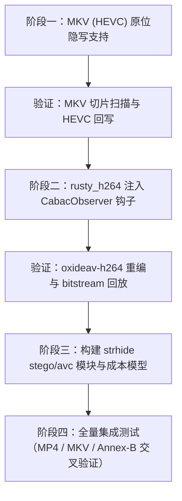

# strhide 视频隐写能力扩展方案计划：MKV 容器与 AVC (H.264) 编码

> **文档版本**：v1.0  
> **创建日期**：2026-10-31  
> **状态**：方案与实施计划评估完成，待开发实施  
> **核心原则**：保持全流程**零码率与尺寸膨胀（$\Delta = 0$）**、**零容器结构破坏（原位无损修改）**、**严格标准语法合规**与**极佳抗隐写分析检测能力**。

---

## 1. 概述与背景

当前 `strhide` 内容域（Content Domain）隐写仅支持 HEVC（H.265）视频编码，封装形式涵盖 HEIF 图像、HEVC Annex-B 裸码流以及 ISOBMFF MP4/MOV 容器。

针对用户需求，本计划聚焦于两大高价值、高可行性扩展目标：
1. **阶段一（MKV 容器支持）**：在现有 HEVC 内容隐写引擎基础上，增加对 **Matroska（.mkv）** 容器的解析与切片定位，使包含 HEVC 视频轨的 MKV 文件可直接进行原位隐写。
2. **阶段二（AVC / H.264 编码支持）**：引入 AVC（H.264 / MPEG-4 Part 10）内容隐写引擎，支持主流 High / Main Profile（CABAC 熵编码）的视频原位隐写，覆盖 Annex-B、MP4（`avc1`/`avcC`）及 MKV（`V_MPEG4/ISO/AVC`）。

注：AV1 与 VP9 由于缺乏成熟纯 Rust 码流级语法解析与带上下文 Observer 的算术重编码基础设施，且多符号算术编码在比特翻转后实现 $\Delta = 0$ 极其困难，在现阶段予以忽略。

---

## 2. 阶段一：MKV 容器支持（内嵌 HEVC 编码）

### 2.1 技术原理与架构决策

#### 为什么不使用通用的音视频解复用库（如 `symphonia`、`matroska-demuxer`）？
* **核心冲突**：`symphonia`、`matroska-demuxer` 等播放型 Demuxer 的目标是将压缩数据解码或拷贝至堆内存缓冲区（`Packet::buf` 或 `Frame.data: Vec<u8>`），它们完全抹去了媒体数据在原始物理文件中的字节起止偏移量（Byte Offset）。
* **后果**：若采用此类库，隐写完成后必须对 MKV 进行“重新打包（Re-mux）”，重封装会改变 Cluster 分块、时间戳索引（Cues）、EBML 元素排布，彻底破坏了原位覆盖与 $\Delta = 0$ 的设计红线。

#### 最优路线：轻量零拷贝 EBML Span 扫描器
* `strhide` 的 HEVC Scheme C 引擎（[rust/src/stego/hevc/engine.rs](file:///c:/Home/Projects/strhide/rust/src/stego/hevc/engine.rs)）仅需：
  1. 不可变参数集序列（VPS, SPS, PPS）；
  2. 每一个切片 VCL NAL 单元在文件中的绝对物理区间（`PhysicalNalSpan { start, end }`）。
* Matroska 规范中：
  * HEVC 视频轨的 `CodecID` 为 `V_MPEGH/ISO/HEVC`；
  * `CodecPrivate` 存放的即为标准 `HEVCDecoderConfigurationRecord`（与 MP4 `hvcC` 盒二进制布局 100% 一致）；
  * `Cluster` 中的 `SimpleBlock`（`0xA3`）或 `BlockGroup` -> `Block`（`0xA1`）直接承载以大端长度前缀（HVCC 格式）开头的切片 NAL。
* `strhide` 内部在 [rust/src/structure/adapters/ebml.rs](file:///c:/Home/Projects/strhide/rust/src/structure/adapters/ebml.rs) 中已拥有 `read_element_id`、`read_vint_size` 等底层解析原语。因此只需编写一个专用的只读切片定位模块 `mkv_boxes.rs`（约 300~400 行 Rust），即可实现零堆拷贝、零依赖膨胀的物理切片扫描。

---

### 2.2 详细设计与实现步骤

#### 1. 新增 `rust/src/stego/hevc/mkv_boxes.rs`
* **EBML 树遍历机制**：
  * 读取 `EBML Header`（`0x1A45DFA3`），确认 DocType 为 `matroska` 或 `webm`；
  * 定位 `Segment`（`0x18538067`）；
  * 解析 `Tracks`（`0x1654AE6B`）：
    * 遍历 `TrackEntry`（`0xAE`），检查 `TrackType == 1`（Video）；
    * 验证 `CodecID == "V_MPEGH/ISO/HEVC"`；
    * 提取 `TrackNumber`（VINT）；
    * 提取 `CodecPrivate` 字节，直接复用现有的 `heif_boxes::parse_hvcc_record`，提取 VPS/SPS/PPS 原始字节与 `length_size`。
* **Cluster 遍历与 Block 偏移计算**：
  * 遍历 `Segment` 下所有的 `Cluster`（`0x1F43B675`）；
  * 查找 `SimpleBlock`（`0xA3`）与 `BlockGroup`（`0xA0` -> `Block 0xA1`）：
    * 解析 Block Header：
      * Track Number（EBML VINT，比对是否为目标视频轨，非目标则直接跳过整个 Block）；
      * Timecode（2 字节有符号大端整型）；
      * Flags（1 字节：bit 7 为关键帧标识，bit 0-2 为 Lacing 标志）。
    * 处理 Lacing：
      * 若 `flags & 0x06 == 0`（无交织，绝大部分视频帧的默认格式）：整个 Block 数据段即为一个或多个 HVCC NAL 单元；
      * 若存在交织（EBML/Xiph/Fixed Lacing）：解析交织头计算帧偏移，或者遇到非常规交织时诚实抛出 `Unsupported` 错误。
    * 解析 HVCC 长度前缀：根据 `length_size`（通常为 4 字节），计算每个切片 NAL 的物理偏移：
      $$\text{start} = \text{block\_payload\_offset} + \text{length\_size}$$
      $$\text{end} = \text{start} + \text{nal\_len}$$
      将 `PhysicalNalSpan { start, end }` 压入列表。

#### 2. 更新 Carrier Sniff 与引擎分发
* 在 [rust/src/stego/hevc/sniff.rs](file:///c:/Home/Projects/strhide/rust/src/stego/hevc/sniff.rs) 中：
  * `HevcCarrierKind` 增加枚举项 `MkvContainer`；
  * `sniff_hevc_carrier` 增加对 `FileFormat::Mkv` 的支持。
* 在 [rust/src/stego/hevc/engine.rs](file:///c:/Home/Projects/strhide/rust/src/stego/hevc/engine.rs) 中：
  * 在 `record_carrier_state` 中加入 `HevcCarrierKind::MkvContainer` 分支，调用 `mkv_boxes::parse_mkv_targets`；
  * 其余 STC 矩阵求解、CABAC 重编码回放、多轮 EPB 防竞争冲突避让机制**完全复用，无需做任何改动**。
  * `apply_hevc_patches` 直接对 MKV 文件执行原位内存覆写。

#### 3. 边界与异常处理
* **未知大小 Segment（Streaming MKV）**：EBML 数据大小为全 1（`VINT = 0x01FFFFFF...`），Scanner 需容忍并在到达文件结尾时正常退出。
* **Cluster CRC-32**：若 MKV 文件使用了 Cluster 层 CRC-32 校验（元素 ID `0xBF`），在打补丁后需更新被修改 Cluster 的 CRC32，或在检测到 CRC32 时记录并在写入时统一刷新。

### 2.3 预期投入与产出
* **代码量**：约 350 ~ 450 行 Rust。
* **开发工时**：1 ~ 2 人天。
* **产出**：`strhide` 原生支持任意 HEVC/H.265 MKV 格式视频的原位隐写与无损提取。

---

## 3. 阶段二：AVC (H.264) 编码内容隐写引擎

### 3.1 技术原理与核心机制（Scheme C for AVC）

#### 1. 算法依据：CABAC Bypass 旁路模式调制
* 根据 ITU-T H.264 标准 §9.3.2.3，在 CABAC 熵编码模式下，残差变换系数的符号位（`coeff_sign_flag`）采用 **等概率旁路模式（Bypass Mode, $p=0.5$）** 编码。
* **数学等价性**：翻转 Bypass 符号位不会引起上下文模型状态（MPS/LPS 概率）的任何转移与漂移。
* **相比 HEVC 的优势**：H.264 没有 Sign Data Hiding（SDH，符号位推断隐藏），每一个非零高频系数均有显式的符号位，槽位映射关系严格确定。

#### 2. 几何失真代价模型（Cost Model）
* H.264 残差采用 4×4 整数 DCT 与 8×8 整数 DCT（High Profile）。
* 系数符号翻转从 $+dq$ 变为 $-dq$，在频域的变化量为 $2 \cdot dq$。
* 根据反变换基函数峰值能量推导单点像素畸变，结合宏块 QP 量化步长、色度平面权重与曼哈顿频域掩蔽系数，构建类似 HEVC 的编译期几何代价表 `COST_GEOM_LUT_AVC`（尺寸约 30 KB）。

---

### 3.2 现有资产复用方案（免造轮子）

基于本地已有代码库，实施方案具备坚实基础：

#### 1. 解码与观察者挂载：`F:\Develop\github\rusty_h264`
* 引用本地仓库：`rusty_h264-decoder` 是纯 Rust、无 `unsafe`、经过 openh264 严密验证的工业级 H.264 解码器。
* 在其 `crates/rusty_h264-decoder/src/mb16.rs` 中，符号位解码已清晰分离：
  ```rust
  if e.decode_bypass_sign() != 0 {
      level = -level;
  }
  ```
* **改造任务**：
  * 参照 `rusty_h265` 的 Observer 模式，在 `rusty_h264` 中定义 `H264CabacObserver` trait；
  * 在 `Engine::decode_decision`、`Engine::decode_bypass`、`decode_bypass_sign` 以及 Slice 结束处嵌入观察者触发点；
  * 报告宏块级别参数（QP、变换块尺寸 4/8、色彩分量、频域坐标 $(x, y)$）。

#### 2. 算术重编码与比特流回放：`F:\Develop\github\oxideav-h264`
* 引用本地仓库：`oxideav-h264` 在 `src/encoder/cabac_engine.rs` 中已经实现了规范级的 `CabacEncoder`。
* 支持 `EncodeDecision`、`EncodeBypass`、`EncodeTerminate`，并自带完善的进位处理（`outstanding_bits`）与 `RenormE`。
* **复用任务**：
  * 直接引入 `CabacEncoder`，在切片重新编码时逐 bin 回放记录的 journal，对标记为翻转的 bypass bin 取反（`bit ^ 1`），重新生成 RBSP 字节流；
  * 对比重编码输出与原始 RBSP 长度，严格确保 $\Delta = 0$。

---

### 3.3 `strhide` 内部模块结构与开发路线

在 `rust/src/stego/` 下建立全新的 `avc/` 模块：

```text
rust/src/stego/avc/
├── mod.rs               # 公开 API (embed_avc, extract_avc, probe_avc_capacity)
├── bitstream.rs         # H.264 Annex-B 切分，1 字节 NAL 头解析，EPB (0x03) 校验
├── mp4_boxes.rs         # ISOBMFF avc1 / avc3 采样项与 avcC 配置盒解析
├── mkv_boxes.rs         # Matroska V_MPEG4/ISO/AVC 轨与 Block 解析
├── slot.rs              # BinOp 紧凑存储 (16-bit), StegoSlot, CabacRecorder
├── cost.rs              # 4x4 / 8x8 DCT 畸变代价模型与 LUT
└── engine.rs            # STC Trellis 求解, 32B Superblock v2, Rayon 并行重编, EPB 迭代
```

#### 关键技术点与工程细节：
1. **参数集指纹与密钥派生**：
   * 采集 SPS（`nal_unit_type = 7`）与 PPS（`nal_unit_type = 8`）原始字节，计算 `cover_digest = SHA-256(cover_salt ‖ sps ‖ pps)`；
   * 通过 HKDF 派生 AES-256-GCM 密钥与 STC Trellis 种子，保证无凭据者面对载体时完全不可定位。
2. **微头与 Superblock 布局**：
   * 完全沿用现有的 32 字节 Superblock v2 格式与微头规范（Micro Header），确保与 `strhide` 现有加密与认证协议一致。
3. **EPB 防竞争避让（最多 24 轮迭代）**：
   * 检查重编码后的 RBSP 是否产生了新的 `0x000000`~`0x000003` 序列或消除了旧序列；
   * 若产生冲突，将冲突窗口对应的 slot 代价置为无穷大并重新运行 STC Trellis 回溯，直至 NAL 字节完全等长。

### 3.4 预期投入与产出
* **代码量**：
  * `rusty_h264` 注入 Observer 补丁：约 150 行 Rust；
  * `strhide/src/stego/avc/` 引擎模块：约 2,000 ~ 2,500 行 Rust。
* **开发工时**：1 ~ 2 周（约 5 ~ 8 人天）。
* **产出**：支持主流 H.264/AVC 视频（MP4/MKV/Annex-B）的工业级原位零膨胀隐写。

---

## 4. 分阶段实施里程碑与时间表



| 阶段 | 任务目标 | 核心输出 | 预计工时 | 依赖前置 |
| :--- | :--- | :--- | :--- | :--- |
| **Milestone 1** | MKV 容器（HEVC）零拷贝切片定位 | `stego/hevc/mkv_boxes.rs`、单测、跨格式兼容 | 1 ~ 2 天 | 无（纯内部开发） |
| **Milestone 2** | `rusty_h264` 增加 `CabacObserver` | `rusty_h264` 补丁分支与测试用例 | 2 天 | `rusty_h264` 源码 |
| **Milestone 3** | AVC CABAC 重编码与 $\Delta=0$ 验证 | `oxideav-h264` 与 `BinOp` journal 回放测试 | 2 天 | `oxideav-h264` 源码 |
| **Milestone 4** | `stego/avc` 核心引擎实现 | STC 求解、Superblock 锚定、代价 LUT | 3 天 | Milestone 2, 3 |
| **Milestone 5** | AVC 容器适配与综合基准测试 | MP4/MKV AVC 支持、CLI/GUI 接入、hash 基线测试 | 2 天 | Milestone 1, 4 |

---

## 5. 质量保证与验收标准

1. **字节级无损还原（Bit-Exactness）**：
   * 提取隐写数据后的明文必须通过 SHA-256 与原始载荷逐字节一致校验；
   * 空载体或错误密码时，必须在 20ms 内诚实返回 `NoHiddenData` / 认证失败，不发生误判。
2. **零容器破坏与严格播放器兼容（$\Delta = 0$）**：
   * 隐写生成的新 MKV/MP4 视频文件，容器头部、索引表大小、物理偏移量与原文件完全一致；
   * 生成的文件必须通过主流播放器（VLC, MPV, Windows Media Player, Chrome）无错误流畅播放，画质无肉眼可觉察失真。
3. **性能与内存基线**：
   * 无论视频时长与文件大小（即使为 10GB+ 4K 视频），单次嵌入峰值内存必须控制在 250MB 以内（流式分窗特性）。
   * `cargo clippy --all-targets --all-features -D warnings` 全绿通过。
