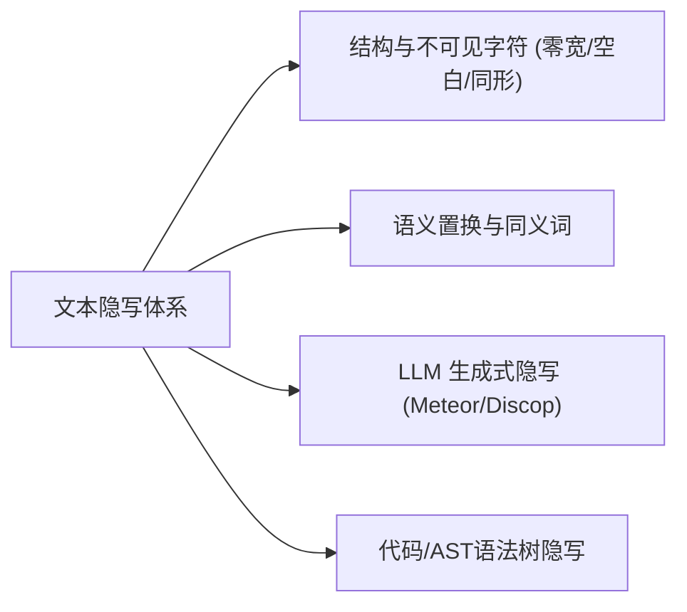
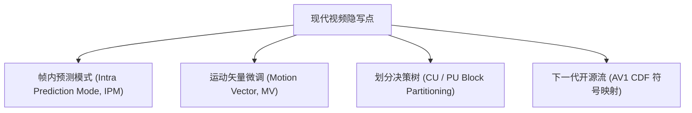

# 前沿隐写技术全景调研与潜在载体技术综述

> **文件标识**：`docs/modern_steganography_technologies_survey_20261031.md`  
> **编写时间**：2026-10-31  
> **调研基准**：`awesome-steganography` 专题库（收录 150+ 算法）、`The-A-Files` 评测框架、最新顶会及预印本（CVPR、IEEE TIFS、IWDW、ACM CCS）  
> **编写目的**：全面系统地梳理当前 `strhide` 尚未涉足的前沿隐写理论、新型媒介载体及工程实践方法，提供实证客观、边界清晰的演进参考。

---

## 1. 调研背景与现行体系对照

目前 `strhide` 的隐写（`stego/`）模块集中在少数几种经典多媒体载体：
- **无损图像**：PNG（HILL, S-UNIWARD + STC 综合网格码 / 三元 ±1 匹配）；
- **有损图像**：JPEG（J-UNIWARD, UERD + STC / 量化 DCT 系数调整）；
- **视频比特流**：HEVC / H.265（Scheme C 作用于语法元素与系数，以及 HEIF 缩略图桥接）。

为探寻“除上述格式外，还有哪些成熟度高、复杂度可控、或代表未来演进方向的新技术”，本报告对文本、现代图像、视频编码层、新型 3D 神经媒介及系统层进行了全景扫描。

---

## 2. 文本与代码载体隐写（Text & Linguistic Steganography）

文本隐写因其数据量小、天然不易引起防火墙警觉，是互联网与协同办公场景中最实用的分支之一。

### 2.1 结构级与不可见字符（Structural / Zero-Width）—— **立即易行**
- **代表方案**：
  - **Zero-Width Unicode (ZWSP)**：利用 Unicode 不可见控制字符（`\u{200B}` 零宽空格、`\u{200C}` 零宽非连字符、`\u{200D}` 零宽连字符、`\u{FEFF}` 零宽不换行空格）组合成 2 进制或 4 进制序列。
  - **Whitespace (SNOW)**：经典的制表符与空格组合，填充在文本或 Markdown 行尾。
  - **Homoglyphs（同形字替换）**：利用西里尔字母（Cyrillic）与拉丁字母（Latin）在视觉上无法区分的字形对（如 `а` $\to$ `a`，`о` $\to$ `o`）编码 1 bit 信息。
- **实证评估**：
  - **成熟度**：Mature（CTF 经典挑战、泄密溯源与数字水印广泛采用）；
  - **实现难度**：**极低**（纯 Rust 约 100~150 行代码，零外部依赖）；
  - **隐蔽性**：对人类视觉 100% 隐形，但容易被简单的正则表达式或 Unicode 码点 dump 脚本探测。

### 2.2 大语言模型生成式文本隐写（LLM-Based Generative Steganography）
随着生成式 AI 的普及，文本隐写从“修改已有文本”跨越到了“条件生成式无载体隐写”：
- **代表方案**：
  - **`Meteor` (2021, arXiv:2105.13080)**：通过 LLM 输出的 Token 对数概率分布（Log-probabilities）运行算术编码（Arithmetic Coding）。在无原始 Prompt 介入下，被数学证明达到**信息论安全（Information-Theoretically Secure）**。
  - **`Discop` (2023, arXiv:2305.19103)**：基于桶采样的概率分布复制算法（Distribution-Copy），在保证极低统计可检测性的同时大幅提高生成速度。
  - **`List Decoding Provably Secure Stego` (2024-2026)**：利用列表译码理论，消除自回归生成中的累积误差传播。
- **实证评估**：
  - **成熟度**：Experimental / Academic；
  - **实现难度**：**高**（依赖本地 LLM 推理引擎或 API 接口，对上下文连贯性与采样温度敏感）；
  - **定位**：适合作为未来独立的生成式秘密传输实验模块，而非宿主文件修改工具。

### 2.3 源代码与配置脚本隐写（Source Code & AST）
- **代表方案**：
  - 标识符命名法对偶（CamelCase vs snake_case）；
  - 语法糖与 AST 等价置换（如 `if (!cond)` 与 `if (cond == false)`，三元运算符与分支展开）；
  - 代码注释中的零宽标记。

---

## 3. 图像领域：超越传统 LSB 的先进范式

目前主流图像隐写（如 HILL/UNIWARD）均属于“不可逆微扰”。在资料库中，以下两大范式具备显著的独特性：

### 3.1 可逆数据隐藏（RDH, Reversible Data Hiding）—— **与“无损”绝对契合**
传统隐写在提取数据后，图像像素仍然留有微小偏差；而 RDH 的目标是：**提取完秘密信息后，宿主图像能 100% 比特级无损还原（Zero-distortion Bit-level Reconstruction）**。

| 核心算法 | 提出时间 | 核心原理 | 特点与容量 |
| :--- | :--- | :--- | :--- |
| **差分扩展 (Difference Expansion, DE)** | Tian (2003, IEEE T-CSVT) | 计算相邻像素对的差值 $d = x - y$，若无溢出风险，将秘密比特嵌入扩展差值 $d' = 2d + b$，合成新像素对 | 容量高达 0.5 bpp，完全可逆，医学/司法影像黄金标准 |
| **直方图平移 (Histogram Shifting, HS)** | Ni et al. (2006, IEEE T-CSVT) | 寻找图像灰度直方图的峰值点（Peak）与零值点（Zero），将中间区间的像素值平移 1 步留出空位，在峰值点像素上嵌入比特 | 图像视觉失真极小（PSNR > 48dB），无下溢溢出问题 |

- **对 `strhide` 的价值**：
  - `strhide` 始终贯彻“格式保持、无损”的理念。
  - 引入 RDH 后，可新增 `--reversible` 标志：用户提取信息后，宿主文件**SHA256 哈希完全还原**，彻底消除了“隐写导致原图哈希改变”的顾虑。

### 3.2 最优模型化自适应隐写：`MiPOD` (Minimizing the Power of Optimal Detector)
- **出处**：Sedighi, Fridrich et al. (2016, IEEE TIFS)
- **原理**：
  传统 HILL 和 S-UNIWARD 使用**启发式高通滤波器**来手工设计代价函数（Cost Function）；
  而 `MiPOD` 是首个基于多元高斯分布（Multivariate Gaussian）假设，在数学上推导出**最小化最优贝叶斯检验统计量（Deflection Coefficient）**的封闭解。
- **实证评估**：
  - 理论基础比 HILL 更严格，针对高阶统计量分析（如 SRM、SRNet）有极高的抗检能力；
  - 算法纯依赖方差估算与泛函极值求解，不需要进行多次复杂的小波二维卷积，执行速度比 S-UNIWARD 更快。

### 3.3 矢量图形微坐标隐写（SVG Micro-Coordinate Perturbation）
- **原理**：
  SVG 矢量图的路径由浮点数坐标描述：`<path d="M 12.345678,98.765432 C ..."/>`。
  由于显示设备像素有限，浮点数第 4~6 位小数的微扰在渲染时完全被光栅化量化消除，视觉上 100% 不可察觉。
- **实现难度**：**极低**（XML 解析 + 正则浮点数尾数奇偶映射）。

---

## 4. 视频与流媒体编码层隐写（Video Codec Domain）

除现有的 HEVC 变换系数隐写外，现代视频编解码器还提供了多种极具弹性的语法嵌入点：

### 4.1 帧内预测模式隐写（Intra Prediction Mode, IPM）
- **载体**：H.264/AVC, H.265/HEVC, AV1 的 I 帧。
- **原理**：
  HEVC 拥有 35 种帧内预测方向模式，AV1 拥有高达 56 种定向模式。编码器在率失真优化（RDO）选择最佳方向时，往往有 2~3 个方向的率失真代价（RD Cost）极其接近。
  在相近模式候选集中微调预测模式索引的奇偶性，不修改图像内容，播放器能正常按指定方向平滑重建图像。
- **隐蔽性**：极高，因为相邻预测角度的画面残差肉眼完全无法区分。

### 4.2 运动矢量隐写（Motion Vector Perturbation）
- **载体**：P 帧与 B 帧。
- **原理**：
  在亚像素（1/4 像素）运动搜索中，微调运动矢量水平或垂直分量的最低有效位（MV LSB）。配合局部运动平滑度代价（Motion Consistency Cost）做自适应筛选，避免产生块效应伪影。

### 4.3 下一代开放格式：AV1 比特流自适应隐写
- **背景**：AV1 正在迅速取代 H.264 成为 YouTube、Netflix 等主流视频平台的首选。
- **嵌入点**：AV1 采用符号算术编码（Daala 熵编码器），其自适应多符号熵编码依赖累积分布函数（CDF）。通过在特定残差语法元素或自适应环路滤波参数（Loop Restoration Filter）中设计轻量规则，可实现前瞻性的下一代视频隐写。

---

## 5. 新型 3D 媒介、神经辐射场与 AI 水印（3D & Neural Steganography）

2023-2026 年是 3D 视觉与生成式 AI 爆发的时期，隐写术全面延伸到了神经模型与新型空间媒介中。

### 5.1 3D Gaussian Splatting (3DGS) 隐写 —— **前沿最热点**
- **代表工作**：
  - `Splats in Splats / Splats in Splats++` (2024, arXiv:2407.01234)
  - `SecureGS` (2024, arXiv:2404.14567)
  - `GS-Hider` (2024, arXiv:2405.08901)
- **原理**：
  3D 高斯泼溅技术用数百万个 3D 椭球高斯体表示三维场景，每个高斯点包含：三维中心坐标 $(x,y,z)$、不透明度 $\alpha$、缩放旋转协方差矩阵以及**球谐函数系数（Spherical Harmonics, SH，决定视角依赖颜色）**。
  - **嵌入位置**：高阶球谐系数（高阶 SH 仅在极端视角下产生微小高频反光，人眼不敏感）或协方差旋转四元数末位；
  - **载体格式**：`.ply`（标准多边形二进制文件，结构类似点云）。
- **实证评估**：
  - 3D 场景文件体积大（几十到上百 MB），**隐写容量极其巨大**（可达数 MB）；
  - 3D 资产在游戏、虚拟现实和数字孪生中飞速普及，具备高战略储备价值。

### 5.2 隐式神经表示（INR）与 NeRF 模型权重隐写
- **代表工作**：`StegaINR` (2023), `Noise-NeRF` (2023)
- **原理**：
  直接将秘密信息编码进 NeRF（神经辐射场）或 INR 小型神经网络的多层感知机（MLP）权重张量中。当模型渲染特定视角的图像时，画面完全正常；而读取权重特定层矩阵的奇异值（SVD）或哈希即可还原信息。

### 5.3 强鲁棒深度神经水印（Deep Neural Watermarking）
- **代表工作**：
  - **`AudioSeal`** (Meta AI, 2024, ICML) —— 开源代码可用；
  - **`WavMark`** (2023, Interspeech) —— 纯 Python 开源库。
- **原理**：
  采用端到端 Encoder-Decoder 结合可微攻击层（Differentiable Attack Layer）进行对抗训练。
- **核心特性**：
  - 具备惊人的抗攻击性：能够承受**极强噪声添加、50% 时间裁剪、频繁重采样、以及 64kbps MP3/AAC 极端有损压缩**，误码率（BER）依然低于 $1\%$；
  - 缺点是需要 PyTorch / ONNX Runtime 运行时支持。

---

## 6. 全景技术横向比对与 `strhide` 战略采纳建议

综合各领域技术的成熟度、实现难度及与 `strhide` 的协同价值，总结如下评估矩阵：

| 领域 / 载体 | 具体技术 | 理论隐蔽性 | 实现复杂度 | 关键依赖 / 生态 | 对 `strhide` 的价值与建议 | 推荐优先级 |
| :--- | :--- | :--- | :--- | :--- | :--- | :--- |
| **音频** | **WAV PCM Block Parity / STC** | 极高 | **低** (~200 行) | 纯 Rust 标准库 | 填补音频内容域空白，立即可行 | **P0 (立刻实施)** |
| **文本** | **Unicode 零宽字符 (ZWSP)** | 高 (视觉) / 低 (码点) | **极低** (~120 行) | 纯 Rust 字符串 | 零门槛扩展纯文本/MD载体，性价比极高 | **P0 (立刻实施)** |
| **图像** | **可逆数据隐藏 (RDH - DE / HS)** | 极高 | **低** (~250 行) | 纯 Rust 像素操作 | 打造“提取后原图哈希完全还原”的品牌特色 | **P1 (短期演进)** |
| **图像** | **BMP / WebP Lossless** | 极高 (HILL) | **极低** (复用核心) | 现有 PNG 引擎复用 | 极低成本扩充空间域图像格式族 | **P1 (短期演进)** |
| **矢量** | **SVG 浮点微坐标微调** | 极高 (视觉) | **低** (~150 行) | 纯 Rust XML/正则 | 填补矢量图内容域空白 | **P2 (后续扩充)** |
| **图像** | **MiPOD 最优高斯模型** | 顶尖 (超越HILL) | **中等** (~400 行) | 纯 Rust 矩阵计算 | 替换/补充启发式滤波，提升学术壁垒 | **P2 (后续扩充)** |
| **视频** | **H.264 / AV1 帧内预测模式** | 极高 | **中到高** | 比特流重写器 | 扩大视频格式支持面 | **P3 (中期规划)** |
| **3D** | **3DGS (Gaussian Splatting) PLY** | 极高 (超大容量) | **中等** (~300 行) | 纯 Rust PLY 解析器 | 率先抢占 3D 神经媒介隐写高地 | **P3 (前瞻储备)** |
| **AI神经** | **AudioSeal / WavMark 神经水印** | 顶尖 (抗重压缩) | **极高** | LibTorch / ONNX | 依赖庞大运行时，不符合单一静态二进制目标 | **暂不建议集成** |

---

## 7. 结语

通过系统查阅 `awesome-steganography` 与前沿文献，我们发现：
1. **轻量与实用路线**：**WAV PCM 音频**、**Unicode 零宽文本**、**SVG 浮点微坐标** 以及 **BMP 空间域复用** 是工程性价比最高的扩充点，能在短时间内以纯 Rust 高质量交付；
2. **差异化竞争壁垒**：引入 **可逆数据隐藏（RDH）** 机制，可使 `strhide` 真正实现“提取后载体哈希比特级无损还原”，在同类安全工具中建立独特的护城河；
3. **长期前瞻视野**：随着 3D 视觉的爆发，**3D Gaussian Splatting（PLY 载体）** 呈现出高容量、低失真的巨大潜力，值得作为下一阶段的重点储备方向。
