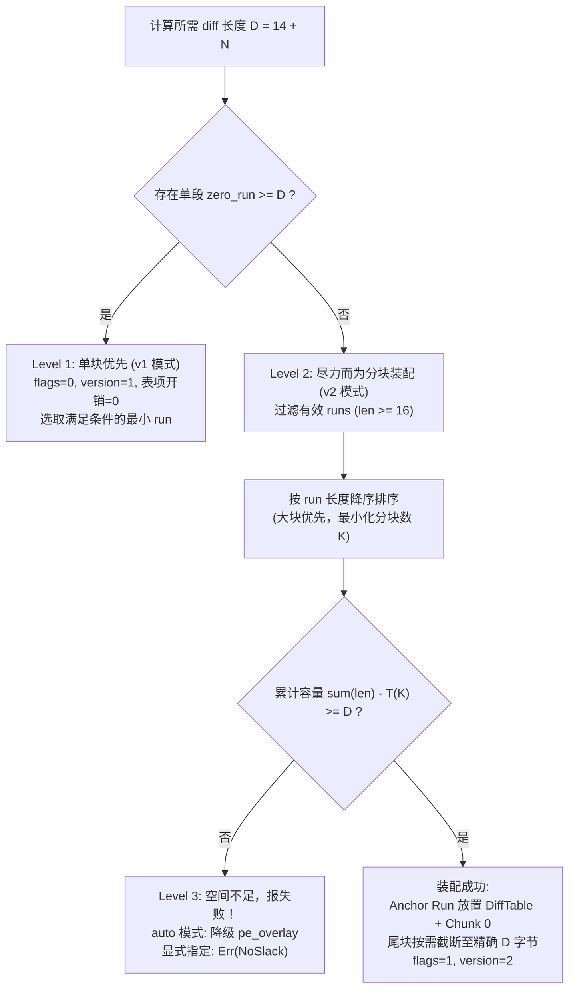

# PE 代码位信道分块还原 diff（pe_codebits v2）设计方案

> 文档编号：STRHIDE-DOC-20261019-01  
> 状态：设计完成 / 待实施  
> 涉及模块：`rust/src/adapters/pe_codebits.rs`、`rust/src/adapters/pe.rs`  
> 关联文档：`pe_codebits_plugin_design.md`（§5.2、§6、§16.1）、`pe_codebits_capacity_analysis.md`

---

## 1. 背景与问题定义

### 1.1 现状与瓶颈

在 `pe_codebits` v1 实现中，PE `.text` 指令编码信道所需的还原 diff 位图（长度为 $14 + N$ 字节）必须存放在 PE 的**单段连续零值 slack** 中。

这导致了严重的容量瓶颈：
- PE 文件通常包含多个节（如 `.text`、`.rdata`、`.data`、`.pdata`、`.rsrc`），每个节尾部因文件对齐（`FileAlignment`，通常为 512 字节）均存在 0 ~ 511 字节的零值 padding。
- v1 仅使用其中**最长的一段连续零 run**，丢弃了其余所有有效零空间。
- 在 `temp/testapps` 实测的 19 个未签名 exe 中：
  - **11 个 exe 受制于 slack（slack-bound）**：`.text` 可改造指令位充足，但最大单段 slack 仅 316 ~ 486 字节，导致可用空间被卡死；若允许合并多段 slack，空间近乎成倍或数倍增长：
    - `WindTerm.exe`: 单段 316 B → 多段总计 **701 B**（+122%）
    - `PE-bear.exe`: 单段 446 B → 多段总计 **1471 B**（+230%）
    - `MPC-BE/mpc-be64.exe`: 单段 478 B → 多段总计 **5790 B**（+1111%）
    - `HxD64.exe`: 单段 458 B → 多段总计 **1512 B**（+230%）
  - **8 个 exe 受制于代码段（text-bound）**：`.text` 本身指令过少（如 `CarroNote` 269 B、`sz` 232 B、`rz` 229 B 等）。

### 1.2 本方案目标

实施方案 B（分块 diff），**彻底打破 slack-bound 瓶颈**：
1. 允许将 $(14 + N)$ 字节的还原 diff 打散存入多个非连续零值 slack 段；
2. 遵循“**尽力而为，空间不够就报失败**”原则，优先单段零开销，不足时多段贪心聚合；
3. 保证 **100% 逐比特无损还原**，向后兼容 v1，防御性规避旧版本误操作与外部数据损坏。

---

## 2. 绝对可靠性设计原则

为保证方案在任何边界、异常及历史版本交互下的绝对可靠，确立以下五大铁律：

### 2.1 `.text` 信道定长，不增加指令位负担
- **禁止将分块描述表（Chunk Table）放入 `.text`**。
  - 在 `.text` 中增加 1 字节数据需消耗 8 个指令位置（约 30 字节机器码），且会导致 diff 位图自身递归增长，得不偿失。
- **`.text` 信道头保持定长 14 字节**：
  - `flags & 0x01 == 0`（单块）：`slack_off` 为唯一 diff run 的文件绝对偏移；
  - `flags & 0x01 == 1`（分块）：`slack_off` 为**主锚点 slack 中分块描述表（DiffTable）的文件绝对偏移**。
- `.text` 内部提取 UBE 的起始偏移（14 字节起）、位图展开规则、容量需求（$(14+N) \times 8$ 比特）**完全不变**，信道编解码层零扰动。

### 2.2 容器版本隔离，阻断旧版损坏
- 旧版客户端（v1）在 `strip` 时默认将 `slack_off` 视为单段连续数据执行读取并清零。若旧版读取分块 carrier，会越界清零导致宿主被毁。
- **安全防线**：
  - 单块模式：维持 `version = 1`, `flags = 0x00`（100% 兼容旧版客户端读写还原）；
  - 分块模式：升级为 `version = 2`, `flags = 0x01`。
- 旧版客户端遇到 `version = 2` 时会在 `validate_header` 阶段主动拦截并报错退出（`unsupported channel version 2`），拒绝篡改文件。

### 2.3 集中式描述表（Centralized Diff Table），放弃链表
- 放弃跨 run 链表跳转设计（链表有死循环、悬挂指针、多点损坏级联风险）。
- 采用**集中式描述表**，放置在主锚点 run 头部，在读写与还原时均支持单次原子 I/O 与整体合法性核验。

### 2.4 防御性全零检验（写入前与还原后闭环）
- 写入前，对选中的所有 chunk 区间（含描述表区间）进行**逐字节校验是否全为 0x00**。只要有 1 字节非零（防御非常规打包器/加壳工具），立即废弃该 run 或终止写入。
- 还原时，将描述表及所有 chunk 区间全部重写为 0x00，结合 UBE 层的 `orig_host_sha256` 进行最终的全文件完整性验收。

### 2.5 Strip 端五重原子安全防线
在 `strip` 阶段，执行任何写盘操作前必须全部通过以下内存校验：
1. **Magic 校验**：描述表必须以 `STCD` 开头；
2. **总量守恒**：$\sum \text{chunk\_len}_k == \text{table.total\_diff\_len} == 14 + \text{channel.ube\_len}$；
3. **边界校验**：每个 chunk 范围 `[offset, offset + len)` 严格位于 `host_size` 内，且不与 PE 头部重叠；
4. **互斥校验**：所有 chunk 区间与 `.text` 代码区间互斥，chunk 之间两两互斥，chunk 与描述表区间互斥；
5. **块数上限**：$1 \le K \le 16$，防御恶意伪造的超大描述表导致 OOM。

---

## 3. 集中式分块描述表（DiffTable）二进制格式

描述表存放在 `slack_off` 指向的文件位置，采用小端序（LE）：

```
+0x00: magic (4 字节, ASCII "STCD" = StrHide Chunked Diff)
+0x04: num_chunks (1 字节, u8, 1 <= K <= 16)
+0x05: flags (1 字节, u8, 保留 0x00)
+0x06: total_diff_len (2 字节, u16 LE, 必须精确等于 14 + ube_len)
+0x08: [Chunk Entry 0] (6 字节)
+0x0E: [Chunk Entry 1] (6 字节)
...
+0x08 + K*6: 表结束，紧随其后可存放 Chunk 0 的 diff 数据
```

### 3.1 表项定义（Chunk Entry，6 字节）

| 偏移 | 字段 | 类型 | 说明 |
|---|---|---|---|
| 0x00 | `offset` | `u32` (LE) | 对应 diff 分块在 PE 文件中的绝对偏移 |
| 0x04 | `len` | `u16` (LE) | 该分块承载的 diff 字节数（PE 节对齐 padding 极少超过 64KB） |

### 3.2 开销测算与锚点利用

- 表头固定 8 字节，每块表项 6 字节：$T(K) = 8 + 6 \times K$ 字节。
  - 2 块：20 字节
  - 3 块：26 字节
  - 4 块：32 字节
  - 6 块：44 字节
- **锚点合并**：将描述表置于所选**最大 run（Anchor Run）的起始位置**。
  - 若 Anchor Run 长度为 $L_0$，则表占前 $T(K)$ 字节，剩余 $L_0 - T(K)$ 字节直接作为 Chunk 0 存放 diff 数据，零内部碎片。

---

## 4. “尽力而为”装配算法（Best-Effort Allocation）

写入阶段对待藏载荷（diff 需求 $D = 14 + N$ 字节）按三级决策流执行：



### 4.1 Level 1：单块优先（Zero-overhead Fast-path）
- 扫描 PE 内所有极大连续零 run；
- 若存在任一 run 长度 $\ge D$：
  - 沿用 v1 规则（选取满足条件的最短 run，并列取偏移小者）；
  - `version = 1`, `flags = 0x00`, `slack_off = run.offset`；
  - 表项开销为 0，与旧版格式完全一致。

### 4.2 Level 2：降序贪心最少块数装配（Min-Chunks Greedy）
- 若无单段满足 $\ge D$，启动分块装配：
  1. **过滤碎块**：剔除长度 $< 16$ 字节的 run（6 字节表项描述 $< 10$ 字节数据，信噪比过低且增加 I/O 碎片）；
  2. **降序排序**：将剩余候选 run 按长度从大到小排序：$R_0, R_1, \dots, R_{m-1}$；
  3. **容量试算**：
     - $R_0$ 为 Anchor Run，扣除 $T(K)$ 字节表头后贡献 $L_0 - T(K)$；
     - 依次累加 $R_1, R_2, \dots$ 的容量；
     - 找到满足 $\sum_{k=0}^{K-1} L_k - T(K) \ge D$ 的最小 $K$；
  4. **尾块截断（Exact Trim）**：
     - 前 $K-1$ 块填满对应 run；
     - 第 $K-1$ 块仅取剩余所需的字节数，该 run 未使用的尾部空间保持原样全零，绝不改写多余字节。

### 4.3 Level 3：硬性失败（Fail Fast）
- 若将所有有效 run 累加扣除 $T(m)$ 后总容量依然 $< D$：
  - **绝不写入任何数据**（不留半成品破坏文件）；
  - 若处于 `auto` 策略选择流程：返回 `"pe_overlay"` 自动平滑降级；
  - 若用户显式指定 `--strategy pe_codebits`：立即返回结构化错误：
    `CodebitsError::NoSlack { need_bytes: D, available_bytes: max_budget }`。

---

## 5. 生命周期与方法适配

### 5.1 `strategy_capacities` 容量报告校准

当前 `pe.rs` 的容量预估直接取 `max_zero_run - 14`，升级为考虑分块上限：

$$\text{cap\_slack} = \max\left(\max(L_i) - 14,\; \sum_{L_i \ge 16} L_i - T(m) - 14\right)$$

- `inspect` 能够准确反映分块后的真实容纳能力，消除“inspect 提示可用但 write 失败”的现象。
- 瓶颈诊断明晰化：在 `note` 中分别提示是由 `.text` 指令数见顶还是由 `slack` 耗尽导致。

### 5.2 `inject_codebits` 流程

1. 解析 PE 布局，读取 `.text` 与候选 slack 区间；
2. 读取 UBE 字节流（$N$ 字节），计算 $D = 14 + N$；
3. 检查 `.text` 可改造指令数 $\ge D \times 8$；
4. 运行装配算法获得分块方案：
   - 单块：`version=1, flags=0, patches=[.text, slack]`；
   - 多块：`version=2, flags=1, patches=[.text, anchor(DiffTable + Chunk0), Chunk1, ...]`；
5. 校验所选所有 slack 区间全部为 0x00；
6. 调用 `pe_codebits::embed` 生成 $D$ 字节 diff 位图；
7. 按切片拆分 diff 并组装 `DiffTable`；
8. 通过 `copy_with_patches` 一次流式写出。

### 5.3 `strip_codebits` 流程

1. 读取 `.text`，解析 14 字节 `ChannelHeader`；
2. 检查 `header.version`（仅接受 1 或 2，其余报错）；
3. 读取 diff 位图：
   - 若 `flags & 0x01 == 0`：在 `slack_off` 处读取 $14 + N$ 字节；
   - 若 `flags & 0x01 == 1`：在 `slack_off` 处读取 `DiffTable`，通过五重校验后，按表项分别读取各 chunk 并拼装成 $14 + N$ 字节 diff；
4. 调用 `pe_codebits::apply_diff` 将 `.text` 翻转恢复；
5. 准备补丁列表：将修改过的 `.text` 替换写回，将涉及的 `DiffTable` 与所有 chunk 区域全部重写为 0x00；
6. 流式写出还原文件，引擎层随后以 `orig_host_sha256` 校验还原一致性。

---

## 6. 异常矩阵与边界防御

| 异常场景 | 触发条件 | 防御措施 | 预期结果 |
|---|---|---|---|
| **旧版客户端还原** | 旧版 strhide 遇到 v2 分块 carrier | `version == 2` 阻断旧版 `validate_header` | 报错拒绝，不执行单块清零，保护载体 |
| **Padding 脏数据** | 打包器往节尾零区填充了私有数据 | `verify_zero_slack` 写入前逐字节检验非零 | 放弃该 run，若总容量不足则报错/降级 |
| **描述表篡改** | 外部程序破坏了 slack 内的表头 | `magic != STCD` 或 `\sum len != total` | 终止 strip，报错 `CorruptedData`，不篡改文件 |
| **碎块重叠** | PE 格式畸变导致节区间重叠 | 表项互斥性区间重叠校验 | 报错拒绝 |
| **跨节截断** | PE 尾部被截断导致某 chunk 超界 | `offset + len > host_size` 校验 | 报错 `CorruptedData` |

---

## 7. 实施计划

1. **第一阶段：核心结构与编解码**
   - 在 `pe_codebits.rs` 中定义 `DiffTable` / `ChunkEntry` 结构体及其 pack/unpack 逻辑；
   - 编写单元测试验证表项编解码与五重校验。
2. **第二阶段：装配算法实现**
   - 实现 `find_slack_plan_streaming`（单块/多块装配器与全零校验）；
   - 编写合成 buffer 测试覆盖 Level 1、Level 2、Level 3 各种边界条件。
3. **第三阶段：适配器接入**
   - 升级 `inject_codebits`、`strip_codebits` 与 `strategy_capacities`；
   - 保持公共 Trait 接口稳定。
4. **第四阶段：真实样本回归验证**
   - 针对 `WindTerm.exe`、`PE-bear.exe`、`mpc-be64.exe` 等 11 个 slack-bound 样本，验证多块注入、读取、还原及 SHA-256 比对闭环。
