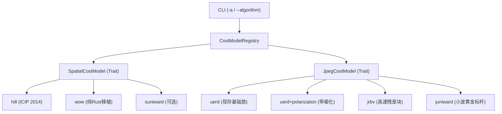

# 内容自适应隐写算法前沿演进与架构优化方案

> 日期：2026-10-21  
> 状态：提案与技术设计 (Proposal & Technical Design)  
> 涉及模块：`rust/src/stego/` (`traits`, `registry`, `params`, `header`, `jpeg/`, `spatial/`, `coding/stc`)  
> 参考工程：`temp/github/stegolab`, `temp/github/phasmcore`, `temp/github/conseal`, `temp/github/hstego`

---

## 1. 背景与调研综述

当前 `strhide` 实现了现代内容自适应图像隐写（Content-Adaptive Steganography）的基础框架，采用基于校验格码（Syndrome-Trellis Codes, STC）的最小失真嵌入范式，并在空域（PNG）和频域（JPEG）分别提供了 `HILL` 与 `UERD` 两个基础代价模型。

经深入调研参考项目（包括 Daniel Lerch 的 `stegolab`、`hstego`、Christoph Gaffga 的纯 Rust 工业级实现 `phasmcore`，以及因斯布鲁克大学的 `conseal`），现代传统修改式隐写在抗深度学习隐写分析网络（如 SRNet、XuNet、YeNet）检测方面已有重大突破。本方案旨在梳理先进算法的引入路径，并完善 `strhide` 的插件化共存与信封自适应识别架构。

---

## 2. 当前 `strhide` 现状核对与瓶颈分析

通过对现有源码实证核对，系统具备良好基础，但仍存在显著的算法演进空间：

| 模块 | 当前实现 | 代码位置 | 现状与核心瓶颈 |
| :--- | :--- | :--- | :--- |
| **空域失真模型** | `HILL` (Li et al., 2014) | `spatial/cost/hill.rs` | 基于 $3\times3$ 高通残差与双层均值滤波的启发式加性失真，缺少多分辨率方向小波与理论统计模型。 |
| **频域失真模型** | `UERD` (Guo et al., 2015) | `jpeg/cost/uerd.rs` | 基于块能量倒数与量化表加权的经验模型；失真完全对称（$\rho^+ = \rho^-$），**未利用量化舍入误差侧信息**。 |
| **隐写编码层** | 非对称三元 STC | `coding/stc.rs` | 完整实现了维特比网格与非对称代价支持，但回溯网格全量保留（内存复杂度 $O(n)$），无分段检查点，超大图内存压力大。 |
| **信封自适应** | 32B 控制头 | `header.rs` | 4 字节控制字已记录 `(len, codec, stc_h, stc_u)`，但**未记录算法代码**；且 Header 槽位依赖 Cost 排序，产生“自举循环依赖”。 |
| **抗检安全策略** | 无上限截断 | `cli.rs`, `engine.rs` | 允许用户接近满载嵌入，而在高相对负载（$>0.05$ bpp）下任何自适应算法均极易被 CNN 检出。 |

---

## 3. 推荐借鉴的先进算法与技术方案

### 3.1 频域 JPEG 算法进阶（收益最高）

#### 方案 A：JPEG 侧信息估计与代价极化（Cost Polarization）—— **P0 优先级**
*   **参考源**：
    *   `temp/github/stegolab/J-UNIWARD/j-uniwardfast-rgbnr-wiener-color.py`
    *   `temp/github/hstego/hstegolib.py`
    *   *JPEG Steganography With Estimated Side-Information* (中科大张卫明团队, IEEE TIFS 2020)
*   **核心原理**：
    *   JPEG 的整数 DCT 系数 $c$ 来源于连续信号的量化舍入。在盲隐写场景下，解压到空域执行 $3\times3$ **二维维纳滤波（Wiener Filter）** 估计去噪连续图像，再重新 DCT 得到浮点估计值 $c_{\text{estim}}$。
    *   若 $c_{\text{estim}} > c$，表明原始连续值高于整数值，量化时发生了向下舍入。此时微调 $+1$ 属于**量化误差补偿**，物理上更贴近未压缩图像；微调 $-1$ 则偏离真实信号。
    *   **极化折算**：对顺应趋势的方向失真成本乘以折扣因子 $m \approx 0.65$（$\rho^+ = 0.65\rho$），反向维持原价。
*   **工程价值**：
    *   `strhide` 的 `stc.rs` 原生已支持非对称三元失真（`direction_costs`），只需在现有模型后追加维纳滤波代价打折，**改造成本极低**。
    *   提取端只读 LSB/奇偶校验，**完全无需知晓极化过程，向前向后 100% 盲提取兼容**。
    *   显著拉低 CNN 检测器特征响应。

#### 方案 B：J-UNIWARD 纯 Rust 高性能实现 —— **P1 优先级**
*   **参考源**：`temp/github/phasmcore/src/stego/cost/uniward.rs`
*   **核心原理**：采用 16-tap Daubechies 8 (db8) 小波的三向分解（LH, HL, HH），将 DCT 频域系数变动映射为空域残差相对变化，是自适应隐学界的通用基准标杆。
*   **工程落地参考**：
    *   `phasmcore` 给出了高成熟度纯 Rust 模板，包含 AAN 快速 IDCT 变换、`f32` 内存压缩、分带（Strip-based）流式处理，并修复了经典 MATLAB 代码在边界处的 off-by-one 偏差（arXiv:2305.19776）。

#### 方案 C：J-RBV（基于残差块方差失真）—— **P2 优先级**
*   **参考源**：`temp/github/stegolab/J-RBV/j-rbv-color.py` (Wei et al., 2021)
*   **核心原理**：J-UNIWARD 需模拟每个 DCT 系数对 $23\times23$ 小波领域的扰动，计算耗时较高；J-RBV 在解压空域计算一次 Daubechies 残差，以 $8\times8$ 块内残差和及邻块残差衡量局部复杂度，直接结合量化表算代价。计算速度比 J-UNIWARD 快 10 倍以上，且抗检能力大幅优于 UERD。

---

### 3.2 空域（PNG/BMP）算法进阶

#### 方案 A：WOW (Wavelet Obtained Weights) 纯 Rust 模型 —— **P2 优先级**
*   **参考源**：`temp/github/conseal/src/wow.rs`
*   **核心原理**：Daubechies 8 水平、垂直与对角线小波残差加权。因斯布鲁克大学在 `conseal` 中已经提供了高优化的纯 Rust 2D 可分离卷积实现，可直接集成进 `SpatialCostModel`。

#### 方案 B：MiPOD（基于高斯模型与 Fisher 信息量最小化）—— **P3 优先级**
*   **参考源**：`temp/github/conseal/conseal/mipod/_costmap.py` (Sedighi & Fridrich, TIFS 2016)
*   **核心原理**：不采用人工经验滤波器，而是通过 2D-DCT 局部多项式拟合图像方差 $\sigma^2$，将偏转系数最小化转化为代价函数 $I \propto 1/\sigma^4$，理论完备。

---

### 3.3 编码层与性能升级

#### 方案 A：分段检查点 STC（Checkpointed / Segmented Viterbi）
*   **参考源**：`temp/github/phasmcore/src/stego/stc/embed.rs`
*   **核心原理**：向前维特比递推时，仅定期保留 Checkpoint 状态，回溯时对当前段做局部微重算。将全量回溯表的内存复杂度从 $O(n)$ 降为 $O(\sqrt{n})$，使千万像素级超大图像在低内存环境下不触发 OOM。

#### 方案 B：无分支向量化 Viterbi 步进
*   **参考源**：`phasmcore/src/stego/stc/embed.rs` 中的 `viterbi_step_scalar`
*   **核心原理**：把 128 状态更新解耦为 `gather`（置换加载）、`branchless min`（无分支选优）和 `u128 bit-pack`（掩码打包），彻底消除热循环分支跳转，提速 3~5 倍。

---

### 3.4 抗检安全策略（Operational Security）

#### 方案 A：安全嵌入率红线阈值（Safe Capacity Capping）
*   **参考源**：`temp/github/hstego/README.md`
*   **实证规律**：无论使用何种先进失真函数，当相对载荷超过 $0.05 \sim 0.10$ bpp（或 nzAC）时，深度学习隐写分析器的分类准确率都会发生质的跃升（陡增至 90% 以上）。
*   **方案**：在 CLI 中增加高隐蔽模式，或在载荷超过安全阈值（如 $5\%$）时打印警告，引导用户避免满载嵌入。

---

## 4. 插件化共存与参数化配置设计

`strhide` 目前的抽象层已经支持插件化，仅需在现存架构中扩展新类型：



在 `rust/src/stego/registry.rs` 中集中管理：
```rust
pub fn list_algorithms() -> Vec<(&'static str, &'static str, &'static str)> {
    vec![
        ("hill", "Spatial (PNG)", "High-Low-Low content-adaptive filter (ICIP 2014)"),
        ("wow", "Spatial (PNG)", "Wavelet Obtained Weights model (Holub 2012)"),
        ("uerd", "JPEG (JPG)", "Uniform Embedding Revisited Distortion (TIFS 2015)"),
        ("jrbv", "JPEG (JPG)", "Residual Block Variance Distortion (Wei 2021)"),
        ("juniward", "JPEG (JPG)", "JPEG Universal Wavelet Relative Distortion (EURASIP 2014)"),
    ]
}
```

---

## 5. 信封设计与自举悖论（Bootstrap Paradox）解法

### 5.1 隐写安全性与数字代码
在 Envelope 中写入算法数字代号（如 2 个 bit 的整数 `0, 1, 2, 3`），**绝对不会引起特征泄露**：
- 隐写分析依赖的是高阶统计特征（如直方图共生、高频残差分布），而非对离散密文的语义理解；
- 头部槽位经过全载体伪随机置换打散，且位于经过密钥混淆的高熵控制块中，其物理呈现与自然噪声无异；
- 严禁写入 ASCII 明文字符串（如 `"juniward"`），使用紧凑整数是标准做法。

### 5.2 自举死锁现象
当前系统的提取流程依赖 CostModel：
$$\text{Carrier} \xrightarrow{\text{cost\_model}} \text{Costs} \xrightarrow{\text{Sort}} \text{Candidate Slots} \xrightarrow{\text{PRNG}} \text{Header 256 Slots} \xrightarrow{\text{Read}} \text{Header}$$
如果 Header 槽位的定位本身依赖算法排序，则提取端必须**先知道算法**才能读出 Header，形成因果死锁。

### 5.3 优雅解耦方案

#### 方案 1：Header 槽位与 CostModel 彻底解耦（推荐）
*   **实现机制**：
    *   Header 的 256 个槽位**不参与任何 Cost 排序**；
    *   仅根据载体固有的物理合法性规则（如 JPEG 中 $\lvert c \rvert \ge 2$，PNG 中像素属于内部八值类 $[8, 247]$）建立稳定全集；
    *   通过 `header_seed`（由密码派生）在全集中做伪随机均匀抽样，提取 256 个槽位。
*   **收益**：
    *   提取端仅凭密码即可 100% 确定读出 Header；
    *   从 Header 解出 `algorithm_id` 后，再动态创建对应算法模型，对后续的 Body 槽位进行 Cost 排序与 STC 解码；
    *   256 个微调槽位在百万级载体中占比低于 $0.03\%$，对整体隐蔽性几乎无影响。

#### 方案 2：微调 32-bit Header Word
当前 [`header.rs`](file:///c:/Home/Projects/strhide/rust/src/stego/header.rs#L37-L40) 中的 4 字节控制字定义为：
```text
bit  0..26  envelope length (64 MB，图像隐写存在显著余量)
bit 26..28  codec id (2 bits: 0=Hamming, 1..=3=STC u=1..3)
bit 28..32  STC h (4 bits)
```
微调为：
```text
bit  0..24  envelope length (16 MB，对图像隐写载荷充足)
bit 24..26  algorithm_id (2 bits: 0=default/uerd/hill, 1=juniward/wow, 2=jrbv, 3=reserved)
bit 26..28  codec id (2 bits)
bit 28..32  STC h (4 bits)
```
这样无需扩充 Header 尺寸（依然保持 32 字节紧凑规格），即可实现提取端全自动自适应。

#### 方案 3：自适应试探盲解（Trial Extraction）
提取端在 `--algorithm auto` 时，先以默认算法解析并校验 AEAD Tag，失败则顺次尝试备选算法。在算法数量受限（2~3种）时开销极低，作为过渡方案无需变更任何已发布载体的格式。

---

## 6. 分阶段实施路线图

```text
[Phase 1: 极化与安全防线]
   ├── 引入 JPEG 空域维纳滤波代价极化 (Cost Polarization)，挂载于现有 UERD (零格式变动)
   └── 增加隐写安全嵌入率风险阈值控制与 CLI 警告 (--safe-cap)

[Phase 2: 引导头解耦与自适应 Header]
   ├── 重构 plan_slots: Header 槽位基于物理合法基底伪随机抽取，解除 Cost 依赖
   └── Header Word 启用 2-bit algorithm_id，提取端实现全自动算法自适应

[Phase 3: 先进模型引入与多算法共存]
   ├── 移植 conseal 纯 Rust 版 WOW 算法作为 PNG 第二空间模型
   ├── 引入 J-RBV (残差块方差失真) 作为兼顾速度与隐蔽性的中端频域模型
   └── 移植 phasmcore 版 J-UNIWARD 作为频域工业级基准标杆

[Phase 4: 编码器极限性能优化]
   ├── STC 维特比搜索无分支 SIMD 向量化 (gather / branchless min / pack)
   └── 实现分段检查点 (Segmented Checkpoint) STC，峰值内存压缩至 O(√n)
```
