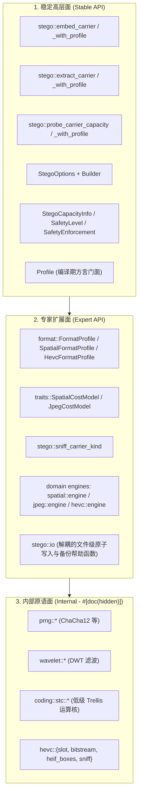
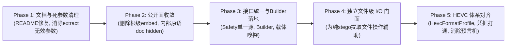

# stego 模块公共 API、CLI 参数与文档全面梳理及优化方案

> **编制时间**：2026-10-24 21:20（本机时间）  
> **文档性质**：架构审计、缺陷定位与设计规范报告（只读梳理，未改动业务代码）  
> **关联项目**：`strhide`（`rust/src/stego/**`、`rust/src/cli.rs`、`rust/src/facade.rs` 等）及第三方消费者 `CarrotHash`（`C:\Home\Projects\CarrotHash`）

---

## 0. 核心宗旨与设计哲学

根据项目定位及实际开发需求，`strhide` 的内容自适应隐写模块（`stego`）面临两个不同的受众和使用场景：

1. **作为底层 Rust 核心库（Library）**：
   - **核心诉求**：提供强大、统一、易用、可深度定制的接口。
   - **定制场景**：第三方开发者（如 `CarrotHash`）可能需要定制**编译期私有参数**（如 HKDF 派生标签、魔数、私有密钥、STC 网格规则、私有代价模型），从而编译出能够防御通用检测、隔离开源工具解析的私有方言二进制。
   - **设计原则**：公开接口必须分层清晰，既有开箱即用的高层门面（Facade/Unified API），又提供完整的常量构造能力（`const Profile` / `FormatProfile`）和可插拔扩展能力（`dyn CostModel`），同时严格收敛内部实现原语（`#[doc(hidden)]`），防止内部演进受限。

2. **作为命令行工具（CLI）**：
   - **核心诉求**：极简、直观、安全、抗脚枪。
   - **设计原则**：**CLI 不需要、也不应该把库暴露的参数全部作为命令行参数公开**。普通用户无需关注 `u/h` 矩阵搜索高度、回溯位图上限或密码学套件内部 ID。CLI 应当分为「日常高频层」、「专家调优层」和「隐藏/高级层」，避免将过于底层、高风险的参数平铺展示在日常帮助中，造成严重的认知负担。

---

## 1. 现状全景与第三方消费实证（CarrotHash）

### 1.1 真实第三方使用实证：`CarrotHash` 的使用方式与痛点

通过对 `C:\Home\Projects\CarrotHash` 的完整代码审计，其对 `strhide` 的依赖与调用体现了典型的第三方私有编译期定制需求：

#### (1) Cargo 特性依赖方式
```toml
# CarrotHash/Cargo.toml
strhide = { path = "../strhide/rust", default-features = false, features = ["stego"] }
```
- **核心发现**：第三方为了二进制极致精简和针对性，关闭了 `default-features`，仅开启 `features = ["stego"]`。
- **引发的问题**：`strhide` 的高级文件门面 `facade.rs` 目前被 `#[cfg(feature = "engine")]` 守卫，这导致**只开启 `stego` 的第三方完全无法使用 `facade::StrHide` 的文件嵌入/提取能力**！

#### (2) 私有方言配置方式
```rust
// CarrotHash/src/stego/dialect.rs
pub const CARROT_JPEG_FORMAT: FormatProfile = FormatProfile {
    format_major: 1,
    format_minor: 0,
    cover_digest_tag: b"carrot-cvr-v1",
    hpos_label: b"carrot-hpos-v1",
    stc_label: b"carrot-stc-v1",
    enc_label: b"carrot-enc-v1",
    perm_label: b"carrot-prm-v1",
    sb_bytes: 44,
    sb_h: 8,
    sb_u: 2,
    ext_h: 8,
    ext_u: 4,
    grid_rule: GridRule::ALL_AC,
    suites: SUITES,
};

pub const CARROT_SPATIAL: SpatialFormatProfile = ...;

pub const DIALECT: Profile = Profile::new()
    .with_stego_secret(STEGO_SECRET)
    .with_stego_domain(STEGO_DOMAIN)
    .with_format_profile(CARROT_JPEG_FORMAT)
    .with_spatial_profile(CARROT_SPATIAL);
```
- **优点**：`Profile` 和 `FormatProfile` 提供了优秀的编译期 `const` 构造能力，无运行时开销，消除了开源指纹。
- **重大盲区**：目前只有 JPEG 和 PNG（Spatial）拥有 Profile 定制接口，**HEVC/HEIC 路径完全没有对应的 `HevcFormatProfile`**！当 CarrotHash 处理 HEIC/HEVC 载体时，私有密钥无法生效，直接回退到官方硬编码默认常量。

#### (3) 选项构造与调用痛点
```rust
// CarrotHash/src/stego/options.rs
let mut opts = StegoOptions {
    password: resolved_pwd,
    safety_level,
    safety_enforcement,
    ..Default::default()
};
// 痛点：因库内部字段割裂，第三方被迫手动同步 4 处 safety
opts.spatial_params.safety_level = safety_level;
opts.spatial_params.safety_enforcement = safety_enforcement;
opts.jpeg_params.safety_level = safety_level;
opts.jpeg_params.safety_enforcement = safety_enforcement;
```

#### (4) I/O 逻辑重复造轮子
由于纯 `stego` 特性无法访问 `facade::StrHide::embed_file`，且缺少文件级 I/O Helper，CarrotHash 不得不在 `ops.rs` 中手工实现了 ~150 行涵盖 `TmpFileGuard` (RAII)、同目录原子 rename、`.bak.N` 递增备份、时间戳保留等逻辑。

---

## 2. 现存问题与混乱点诊断（四大维度）

### 2.1 混乱（Confusion）—— 多重事实源与误导性入口

1. **根级重导出名称极具误导性（P0）**：
   - `strhide::lib` 根级导出了：
     ```rust
     pub use stego::jpeg::engine::{embed_jpeg as embed, extract_jpeg as extract};
     ```
   - 库使用者在根命名空间看到 `strhide::embed` 和 `strhide::extract`，直觉上认为是通用入口，但传入 PNG 或 HEIC 会直接报错崩溃。通用入口实际位于 `strhide::stego::embed_carrier`。
2. **`safety_level` 与 `safety_enforcement` 三处分散且静默覆盖（P1）**：
   - `StegoOptions`、`SpatialParams`、`JpegParams` 各自定义了这两个字段。
   - `stego/mod.rs` 在执行统一分发时，会用 `options.safety_level` **无条件静默覆盖** `spatial_params` 和 `jpeg_params` 的同名字段。
   - 若调用者单独配置了 `spatial_params.safety_enforcement = Enforced`，会被外层的默认 `Advisory` 静默重置，导致安全约束失效。
3. **HEVC（Scheme C）私有密钥静默降级（P0）**：
   - 统一入口在分发到 HEVC 时，传的是 `options.password.as_deref()`，而不是 `options.secret(profile)`。
   - 导致第三方配置的 `Profile::stego_secret` 在 HEVC 路径被直接抛弃，无密码时回退到公开的 `"strhide-hevc-default-key-2026"`，开源工具可随意提取。
4. **提取端死参数误导（P1）**：
   - CLI `extract` 命令暴露了 `--algorithm`、`--neighbor-weight`、`--exclusion-rate`、`--p1-window`、`--p2-window`。
   - 实际上：JPEG 提取不需要代价模型（槽位是几何+密钥决定的）；PNG 提取中算法 ID 和排除率已自描述在载体的 `FeatureWord` 中；`--neighbor-weight` 更是 JPEG 的参数，在 PNG 提取中完全无关。这些参数在提取端全为无效或干扰参数。
5. **双份帮助信息导致数值漂移（P1）**：
   - `cli.rs` 的 clap 注解与 `cli_i18n.rs` / `messages.rs` 分别维护英文和中文帮助。
   - 实证漂移：`messages.rs` 中 `HelpEmbedExclusionRate` 记载默认值为 `0.20`，而代码实际常量（`params.rs:213`）与 `cli.rs:373` 均为 `0.30`。
6. **HEVC 存在性预言机（P0）**：
   - `hevc/engine.rs` 包含硬编码静态魔数 `SH25`，且其 header 槽位通过参数集（VPS/SPS/PPS）计算的摘要定位，**完全不依赖密码**。
   - 任何黑客无需密码即可定位并检查是否存在 `SH25`，直接破坏了隐写的“不可见性/否认性（Plausible Deniability）”。

---

### 2.2 应统一（Unification）—— 概念与优先级的标准化

1. **凭据优先级必须具有单一明确规则**：
   - 口令与域标签的冲突解决逻辑：
     `显式运行时参数 (CLI / StegoOptions) > 编译期方言配置 (Profile) > 官方公开默认值`。
   - 目前该逻辑缺乏文档权威说明，导致开发者难以预期。
2. **默认密钥常量的归一化**：
   - 全仓库目前存在三份互不相干的公开默认密钥常量：
     - 结构域：`crypto::BUILTIN_DEFAULT_KEY`
     - 图像空间/JPEG 域：`stego::envelope::PUBLIC_DEFAULT_SECRET`
     - HEVC 域：`"strhide-hevc-default-key-2026"`（硬编码字面量）
   - 应统一归口到统一的密码学常数体系中。
3. **格式配置命名与语义统一**：
   - 目前 JPEG 格式叫 `FormatProfile`，PNG 格式叫 `SpatialFormatProfile`。
   - `SpatialFormatProfile` 内部居然包含 `pub body: &'static FormatProfile` 字段借用 JPEG 的参数结构，概念耦合严重。
   - 应该规范为各格式解耦、命名对齐的 WireProfile 体系。

---

### 2.3 应规范与合并（Consolidation）—— 公开面分层

1. **公开符号过度外泄**：
   - 目前 `stego` 模块对外暴露了大量内部底层原语：
     `prng::*`（ChaCha12Stream 等）、`wavelet::*`（离散小波变换实现）、`coding::stc::*`（STC Viterbi 底层核）、`hevc::h265`（直接将外部 git 依赖重新导出到公开接口中）。
   - 这些原语对外部开发者毫无用处，反而绑死了内部重构手脚。
2. **多余的“无 Profile”委托薄壳**：
   - `stego/spatial` 和 `stego/jpeg` 中存在：
     - `embed_spatial` 委托给 `embed_spatial_with_profile`
     - `embed_spatial_with_profile` 委托给 `embed_spatial_with_profile_and_freshness`
   - 这些历史包袱应合并收敛，统一对外暴露最完备的入口。

---

### 2.4 应精简（Pruning）—— CLI 降噪

1. **CLI 专家级参数收敛**：
   - CLI `embed` 中将 `--slot-budget`（帮助长达 4 行）、`--cipher-suite`（密码套件 ID）等平铺展示。这些参数属于深度研究/密码学调优参数，日常用户几乎不需要修改。应当在 CLI 中予以收起或标记为高级/隐藏参数。
2. **清理已废弃但在文档宣传的参数**：
   - README（中英文）目前仍大量宣传 `--codec` 和 `--stc-u` 参数，但实际上这两个参数早因自适应 STC 的引入而在代码中被彻底移除。
   - README 宣称空间域默认是 Hamming 编码，但代码实际默认是 Auto（且永远动态分流到 STC u=3/2/1）。

---

## 3. 缺失的公共 API、接口与命令行能力梳理（重点补充）

在本次深度排查中，除上述混乱与多余内容外，我们重点梳理出以下**确实缺失、亟需补齐的公共接口与命令行能力**：

### 3.1 库层面缺失的公共 API 与接口

#### 缺失 1：`StegoOptions` 缺乏类型安全的 Builder 流式构造器
- **现状**：`StegoOptions` 是一个包含很多字段的结构体。外部调用者如果使用 struct literal，必须写一堆 `..Default::default()`，且无法利用编译器辅助校验。
- **缺失接口**：
  ```rust
  impl StegoOptions {
      pub fn builder() -> StegoOptionsBuilder;
      pub fn with_password(mut self, password: impl Into<String>) -> Self;
      pub fn with_safety(mut self, level: SafetyLevel, enforcement: SafetyEnforcement) -> Self;
      pub fn with_algorithm(mut self, algo: impl Into<String>) -> Self;
      pub fn with_domain(mut self, domain: impl Into<String>) -> Self;
      pub fn with_freshness(mut self, freshness: Freshness) -> Self;
  }
  ```

#### 缺失 2：统一入口缺乏自定义代价模型（Trait Object）注入能力
- **现状**：`SpatialCostModel` 与 `JpegCostModel` trait 均已 `pub` 导出，但高层统一入口 `embed_carrier` 只能通过 `options.algorithm: Option<String>` 从硬编码的 `CostModelRegistry` 静态匹配。
- **痛点**：第三方开发者如果研究了新型代价模型（如深度学习生成的代价图、私有滤波器），**根本无法通过高层统一入口使用**，只能绕过所有格式嗅探、HEIF 路由和凭据处理，自己手写底层调用。
- **缺失接口**：
  在 `StegoOptions` 中增加自定义模型插槽：
  ```rust
  pub struct StegoOptions {
      // ... 既有字段 ...
      pub custom_spatial_model: Option<std::sync::Arc<dyn SpatialCostModel>>,
      pub custom_jpeg_model: Option<std::sync::Arc<dyn JpegCostModel>>,
  }
  ```
  统一入口优先使用自定义模型对象；未提供时才走算法名称字符串查询。

#### 缺失 3：缺少轻量级、不依赖结构域 `engine` 的纯 stego 文件 I/O 接口
- **现状**：`facade::StrHide::embed_file` 被 `#[cfg(feature = "engine")]` 限制。纯 `stego` 编译目标（如 CarrotHash）无法调用，被迫自建 150 行文件安全写入、临时文件替换、原子重命名和备份保护代码。
- **缺失接口**：
  在 `stego::io` 或解耦后的 `facade` 提供文件级便捷入口：
  ```rust
  pub fn embed_carrier_file(
      carrier_path: &Path,
      target_path: Option<&Path>,
      payload: &[u8],
      options: &StegoOptions,
      profile: &Profile,
      backup: bool,
  ) -> Result<Option<PathBuf>, StrHideError>;

  pub fn extract_carrier_file(
      carrier_path: &Path,
      options: &StegoOptions,
      profile: &Profile,
  ) -> Result<Vec<u8>, StrHideError>;
  ```

#### 缺失 4：缺少公开的载体类型嗅探与预检函数
- **现状**：目前格式检测散落在 `stego/mod.rs` 的内部 if/else 字节比对中（`FF D8`, `\x89PNG`, `is_heif_bytes`）。外部调用者在调用隐写前，如果想提前预判某个载体是否支持、属于什么格式，必须自己写魔数解析代码。
- **缺失接口**：
  ```rust
  #[derive(Debug, Clone, Copy, PartialEq, Eq)]
  pub enum StegoCarrierKind {
      Png,
      Jpeg,
      Heif,
      HevcAnnexB,
      Unsupported,
  }

  pub fn sniff_carrier_kind(bytes: &[u8]) -> StegoCarrierKind;
  ```

#### 缺失 5：HEVC / Scheme C 缺失全套方言 Profile 与参数定制抽象
- **现状**：JPEG 有 `FormatProfile`，PNG 有 `SpatialFormatProfile`，而 HEVC 内部全是模块常数，无任何 Profile 支持。
- **缺失接口**：
  ```rust
  pub struct HevcFormatProfile {
      pub magic_label: &'static [u8],
      pub cover_salt: &'static [u8],
      pub kdf_info: &'static [u8],
      pub stc_h: u8,
      pub stc_u: u8,
      pub header_bytes: usize,
  }

  pub struct HevcParams {
      pub stc_h: u8,
      pub stc_u: u8,
  }

  // Profile 补齐接口：
  impl Profile {
      pub const fn with_hevc_profile(mut self, profile: HevcFormatProfile) -> Self;
      pub fn hevc_profile(&self) -> &HevcFormatProfile;
  }
  ```

#### 缺失 6：`SafetyLevel` 缺少通用的 `FromStr` 和数字代号解析
- **现状**：`SafetyLevel::parse` 只识别 `paranoid/high/balanced`，不认 `"0"`, `"1"`, `"2"`，第三方（CarrotHash）不得不自行实现别名匹配。
- **缺失接口**：
  为 `SafetyLevel` 实现标准 `std::str::FromStr`，原生支持大小写无关名称以及数字代号（`0`=Paranoid, `1`=High, `2`=Balanced）。

#### 缺失 7：`StegoCapacityInfo` 缺少辅助判断与格式化方法
- **现状**：`StegoCapacityInfo` 只是一堆公开字段，调用者若想判断载体是否容得下某 payload，必须手写比较与容差计算；想要在日志中打印友好的容量描述也缺乏原生格式化支持。
- **缺失接口**：
  ```rust
  impl StegoCapacityInfo {
      pub fn fits_recommended(&self, payload_len: usize) -> bool;
      pub fn fits_max(&self, payload_len: usize) -> bool;
      pub fn summary_string(&self) -> String;
  }
  ```

---

### 3.2 命令行（CLI）缺失的参数与能力

#### 缺失 1：缺乏独立的 `strhide capacity` 快捷子命令或 `inspect` 集成
- **现状**：用户想探测载体容量，必须使用 `strhide embed <CARRIER> --capacity`。这非常别扭，因为 `embed` 语义是“写入”，而探测是“只读”。而且在某些参数组合下，还容易触发 payload 缺失等参数校验干扰。
- **优化建议**：
  - 增加顶层别名或独立子命令 `strhide capacity <CARRIER>`；
  - 或者在现有的 `strhide inspect <CARRIER>` 中，如果发现载体是图片且带有隐写特征或可隐写，直接输出内容隐写的容量评估信息。

#### 缺失 2：缺少机器可读的 `--json` 输出支持
- **现状**：`strhide embed --capacity` 在终端输出一段漂亮的 ASCII 格式文本，但自动化脚本、GUI 客户端（如 CarrotHash 包装器）无法以结构化数据解析。
- **优化建议**：
  为 capacity 探测和 inspect 增加 `--json` 选项，直接输出 `StegoCapacityInfo` 序列化后的 JSON 字符串。

#### 缺失 3：缺少 `--dry-run` 安全演练参数
- **现状**：用户在执行大文件或敏感图片嵌入前，无法在不产生实际磁盘写入的情况下，完整模拟跑完代价计算、STC 路径选择和安全性评估。
- **优化建议**：
  `embed` 增加 `--dry-run`，完整执行内存中的代价计算与 STC 模拟，输出真实的失真度评估和变动率，但不写入目标文件。

#### 缺失 4：缺乏 HEVC/HEIC 路径的明确路由控制参数
- **现状**：对 `.heic` 载体，系统隐式先尝试 Thumbnail Bridge（缩略图隐写），失败后再尝试 Scheme C（CABAC 帧内隐写）。用户若想指定使用某条特定路径，目前只能传 `-a hevc`，语义含糊。
- **优化建议**：
  明确 `-a hevc` 与 `-a cabac` 强制走 Scheme C，或增加清晰的 `--heif-mode <bridge|inplace>` 控制选项。

---

## 4. 优化改进方案（Blueprint）

### 4.1 库架构三层模型（API Surface Tiering）

通过代码分层规范，将当前杂乱的 ~361 个 pub 符号清晰划分为三层：



- **稳定面（Stable）**：仅公开极简的统一入口与配置结构。破坏性改动只随 Major 版本发布。
- **专家面（Expert）**：专门供第三方编译期定制（如 CarrotHash）及自定义代价模型扩展使用。小版本可保持平滑演进。
- **内部面（Internal）**：全部标记 `#[doc(hidden)]`，不对外做任何稳定性承诺，解除内部重构与性能优化的后顾之忧；删除 `pub use rust_h265 as h265` 这种无谓的依赖外泄。

---

### 4.2 第三方编译期定制的目标最佳形态（以 CarrotHash 为例）

优化完成后，第三方宿主接入 `strhide` 将极其优雅自然：

```rust
// 1. 编译期私有方言声明 (零运行时成本，完全消除开源指纹)
pub const DIALECT: Profile = Profile::new()
    .with_stego_secret("W7PNTl9TdhRq8U5wJrV6DEYUUHYtLn88qOuRq/mm3fM=")
    .with_stego_domain("carrothash-domain-v1")
    .with_format_profile(CARROT_JPEG_FORMAT)
    .with_spatial_profile(CARROT_SPATIAL)
    .with_hevc_profile(CARROT_HEVC); // 新增 HEVC 支持，覆盖 HEIC/HEVC 载体！

// 2. 运行时选项构造 (利用流式 Builder，一行搞定，杜绝 4 处重复同步)
let options = StegoOptions::builder()
    .password(resolved_pwd)
    .safety(safety_level, safety_enforcement) // 单一事实源，自动生效
    .build();

// 3. 文件级安全操作 (调用解耦后的文件门面，省去第三方 150 行自建 I/O)
let backup_file = stego::io::embed_file(
    carrier_path,
    output_path,
    &payload,
    &options,
    &DIALECT,
    create_backup,
)?;
```

---

### 4.3 命令行参数三层模型（CLI Pragmatic Layout）

对命令行参数做清晰的主次分层，彻底终结参数堆积和无用参数暴露：

| 层级 | 参数类别 | 覆盖参数 | 行为与界面呈现 |
|---|---|---|---|
| **日常层 (Daily)** | 基础 I/O、凭据、安全策略 | `-t/-d/--stdin`, `-p`, `-o`, `--in-place`, `--overwrite`, `--no-backup`, `-a/--algorithm`, `--safety`, `--enforce-safety`, `--capacity` | `strhide embed --help` 优先展示，提供清晰、紧凑的单行帮助。 |
| **专家层 (Expert)** | 空间/频域自适应调参 | `--exclusion-rate`, `--p1-window`, `--p2-window`, `--neighbor-weight`, `--stc-h` | 归类在独立的分组（Fine-Tuning Options）中展示；在 `extract` 端完全移除 `--neighbor-weight` 和 `--exclusion-rate` 等死参数。 |
| **隐藏层 (Hidden)** | 密码学套件、底层位图上限 | `--slot-budget`, `--cipher-suite` | 设置 `clap(hide = true)`。参数依然生效，可在高级文档中查阅，但不出现在终端日常 `--help` 中，避免认知过载。 |

---

### 4.4 HEVC（Scheme C）安全与一致性闭环方案

针对 HEVC 路径存在的安全与一致性问题，实施以下闭环改造：

1. **统一凭据传递**：统一入口分发到 `embed_hevc` / `extract_hevc` 时，必须传递 `options.secret(profile)` 与 `options.domain(profile)`，确保私有 Profile 密钥不再被静默忽略。
2. **派生化魔数，消灭检测预言机**：将硬编码的 `SH25` 改为由 `HevcFormatProfile.magic_label` 结合口令/私钥派生的 4 字节动态验证标签，杜绝黑客未授权探测隐写状态。
3. **消除第三份公开密钥**：删除硬编码的 `"strhide-hevc-default-key-2026"`，统一回退到 `PUBLIC_DEFAULT_SECRET`。
4. **对齐 WIRE_SPEC 规范文档**：修改 `docs/api/WIRE_SPEC.md` 中与代码不一致的 3 处字面量描述，并加入跨模块自动化一致性单测。

---

## 5. 实施路线图与验证清单

本优化方案分为五个清晰、低风险的步骤：



### 验收与验证标准
1. **编译与 Lint 校验**：
   - `cargo build --release` 编译通过。
   - `cargo fmt --check` 与 `cargo clippy --all-targets -D warnings` 全绿零告警。
2. **测试回归矩阵**：
   - `cargo test --all-targets` 单元测试全部通过。
   - `cargo test --test batch_corpus -- --ignored` 结构域回归无降级。
   - `cargo test --test batch_stego -- --ignored` 隐写批测全量载体无损还原与安全性验证通过。
3. **第三方消费验证**：
   - 将优化后的 `strhide` 引入 `C:\Home\Projects\CarrotHash`，验证 CarrotHash 代码量显著精简（可安全删除约 150 行冗余 I/O 与 4 处重复配置），且编译测试全绿。
